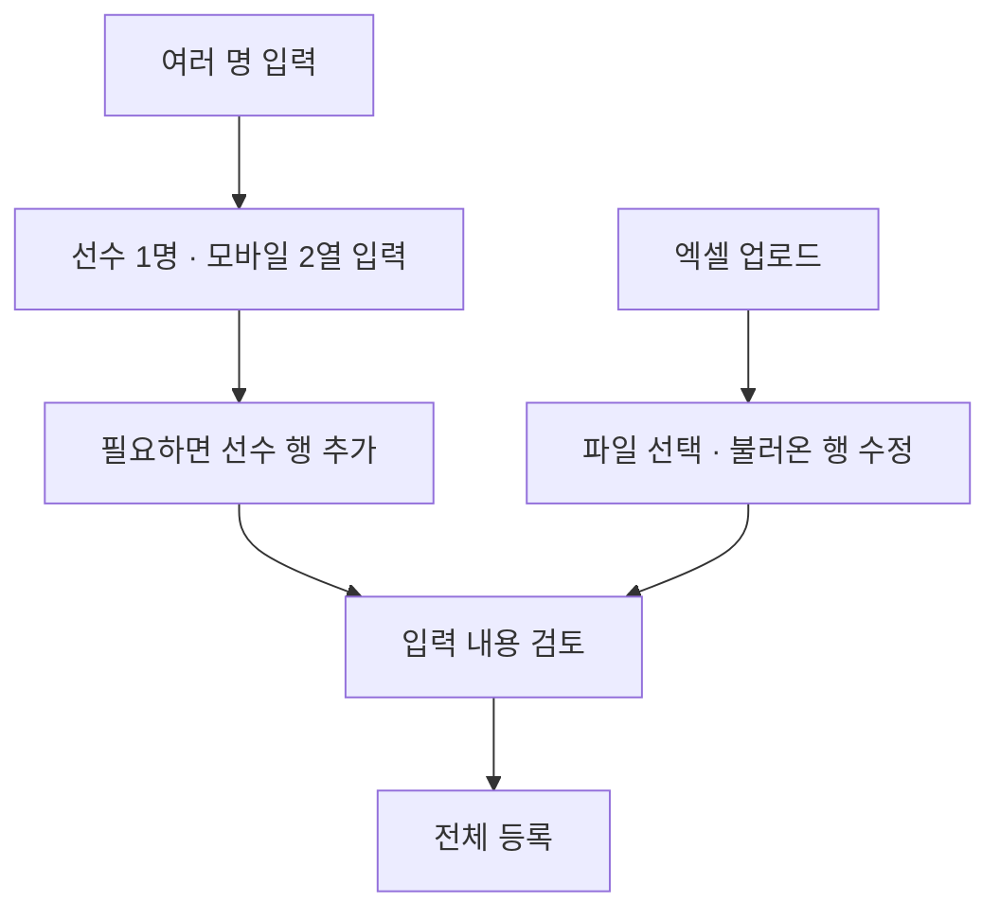

# 선수 입력 모바일 개선 (운영 반영 · 웹 db2391d)

- 여러 명 입력은 빈 선수 1명으로 시작한다. + 선수 행 추가로 최대 200명까지 늘리고 행 삭제로 제거한다.
- 모바일 일반 필드 2열, 선호 포지션 3열. 44px 입력 높이와 16px 글씨를 유지한다. 360px 이하에서는 직접 입력+목록이 있는 항목을 전체 폭으로 표시한다.
- 가입일은 단일 등록과 동일한 달력 입력. 엑셀에서 잘못 불러온 날짜는 숨기거나 버리지 않고 원문 오류 안내와 재선택을 제공한다.
- 엑셀 등록은 파일 업로드 후 내용 수정·행 삭제·검토·전체 등록을 유지하고, 선수 행 추가는 표시하지 않는다.
- 선수 기록은 기본 10명, 20/30명 선택 가능. 선수단 기본 20명은 변경하지 않는다.

## 화면 흐름

## 가이드 반영
운영진: 한 행 시작·행 추가·달력·엑셀 모드의 행 추가 제거 안내.
회원/운영진 공통: 선수 기록 기본 10명 안내. 가이드 1.5 공통 원고·HTML·PDF·앱 가이드에 반영하고 운영 파일 일치를 확인했다.
DB·권한·인프라 관계도 변경 없음. 위 흐름도는 2026-10-17 22:50 KST 운영 반영된 동작이다.

## 경기 결과 집계 후속 변경
04단계는 03단계 실제 출전 행이 있는 선수만 표시한다. 교체·용병·자체전 양 팀 포함, 계획만 배치하거나 출석만 한 선수 제외. 출석 원본은 01단계에 보존하며 0명일 때 03단계 입력 안내를 표시한다. 집계 계산·DB 저장 정책은 변경하지 않는다.

## 검증 결과
- 프론트 263개 테스트 및 TypeScript/Vite 빌드 통과. 기존 큰 번들 경고는 유지.
- 390px/320px 가상 미리보기 확인. 최초 1행, 행 추가/삭제, 키보드로 날짜 선택 후 추가한 행과 기존 날짜 유지 확인.
- 엑셀 진입에서 행 추가 없음·양식 다운로드 유지 확인. 파일 업로드/실제 등록 저장은 이번 검증에서 실행하지 않음.
- 선수 기록 간단/표 보기 모두 기본 10명 확인.
- 실제 출전 집계: 가상 참석 47명 중 출전한 11명 표시. 0명 안내 확인.
- 실제 iPhone 및 백엔드/MySQL 통합 테스트는 미실행. 아래 배포 결과와 별개로 실제 데이터 시험 수정·DB 변경 없음.

[모바일 입력 화면](diagrams/bulk-mobile-20261017.jpg) · [입력 흐름 원본](diagrams/bulk-input-mobile.mmd)

## 배포 확인
2026-10-17 22:50 KST, 웹 `db2391d` / Northflank `near-parcel-4083` 빌드 SUCCESS·배포 COMPLETED. API `d8b2763` 배포 시각 유지, DB V30 변경 없음. 공개 HTTPS 9개 통과, 운영 JS/CSS/역할별 PDF SHA256이 로컬 검증 파일과 일치. GitHub CI 39038189805 프론트 성공, 백엔드는 확인 시 진행 중. 로컬 MySQL 통합 및 실제 iPhone·운영 로그인 업무 재시험은 미실행. 문제 발생 시 직전 웹 `conscious-rule-955`(072ac46)로 복귀 가능.
