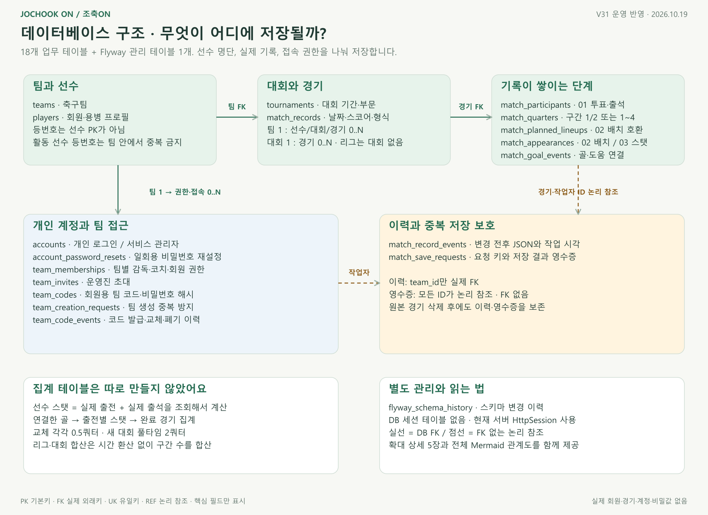

# 조축ON 데이터베이스 관계도

기준: **운영 DB V31 · 2026-10-19 배포 확인**. Flyway V1~V31과 실제 적용된 운영 구조를 설명합니다. V31은 골 한 건의 득점자·도움 선수를 연결하는 `match_goal_events`와 구간별 기록 방식 `match_quarters.goal_events_linked`를 추가합니다. 운영 DB 마이그레이션과 기존 17개 업무 테이블의 행 지문 일치를 확인했습니다. 이 그림에는 실제 행이 없으며, [배포·기능 검증](goal-events-mobile-2026-10-19.md)과 함께 읽습니다.

이 그림은 **ERD(Entity Relationship Diagram, 개체 관계도)**입니다. 어떤 테이블에 무엇을 저장하고, 다른 테이블과 어떤 키로 연결되는지 보여 줍니다. 업무 테이블 18개와 Flyway 관리 테이블 1개를 담았습니다. 실제 회원·경기·계정 행이나 비밀값은 사용하지 않았습니다.

## 그림 보기

[탭으로 전체 그림 보기](diagrams/database/index.html)에서 확대 상세를 선택할 수 있습니다. 휴대전화에서는 그림을 가로로 밀어 읽습니다. GitHub에서 HTML이 실행되지 않으면 아래 PNG 또는 SVG를 엽니다.



| 그림 | 다루는 내용 | 열람본 |
| --- | --- | --- |
| 전체 구조 | 명단·경기·권한·이력이 어떻게 나뉘는지 | [SVG](diagrams/database/00-overview.svg) · [PNG](diagrams/database/00-overview.png) |
| 팀·선수·대회·경기 | 팀별 자료 분리와 대회 연결 | [SVG](diagrams/database/01-team-match.svg) · [PNG](diagrams/database/01-team-match.png) |
| 투표·계획·실제 출전 | 참석·02 배치·교체와 03 득점 기록 | [SVG](diagrams/database/02-lineups.svg) · [PNG](diagrams/database/02-lineups.png) |
| 골·도움 연결 | 골 한 건의 득점자와 선택적 도움 선수, 구간별 집계 방식 | [SVG](diagrams/database/05-goals.svg) · [PNG](diagrams/database/05-goals.png) |
| 인증·권한·복구 | 개인 로그인, 감독·코치 권한, 팀 코드, 비밀번호 재설정 | [SVG](diagrams/database/03-access.svg) · [PNG](diagrams/database/03-access.png) |
| 변경 이력·저장 영수증 | 수정 이력과 중복 저장 방지 | [SVG](diagrams/database/04-audit.svg) · [PNG](diagrams/database/04-audit.png) |

## 읽는 방법

- **PK(기본키)**: 한 행을 구분하는 값입니다. 선수는 `players.id`가 PK이고 등번호는 PK가 아닙니다.
- **FK(외래키)**: DB가 연결을 강제하는 키입니다. 실선 또는 카드의 `FK` 행에 참조 대상을 표시했습니다.
- **UK(유일키)**: 중복할 수 없는 값 또는 값의 조합입니다. 예를 들어 `(team_id, active_shirt_number)`로 같은 팀의 활동 선수 등번호 중복을 막습니다.
- **REF(논리 참조)**: 관련 ID가 있지만 DB 외래키는 없습니다. 점선으로 구분합니다. 원본이 삭제된 후에도 이력이 남아야 하는 경우 등에 사용합니다.
- **1 / 0..1 / 0..N**: 각각 한 행, 없거나 한 행, 없거나 여러 행입니다. 경기 한 건에 참가자 여러 명이 연결되면 `경기 1 : 참가자 0..N`입니다.

복합 PK의 각 컬럼은 함께 한 행을 구분합니다. 상세 그림은 선이 겹치지 않도록 일부 관계를 FK 필드와 관계 설명으로 표시했습니다. **물리 FK 28개 각각의 전체 연결은 [Mermaid 원본](diagrams/database/schema.mmd)과 [구조 JSON](diagrams/database/schema.json)에 있습니다.** Mermaid 점선의 기본 의미는 비식별 관계이므로, 이 파일에서는 외래키가 없다는 뜻을 `REF NO FK`로 함께 명시했습니다.

## 전체 테이블 목록

| 구분 | 테이블 | 저장하는 내용 |
| --- | --- | --- |
| 기본 | `teams` | 팀 이름, 상태, 수정 버전 |
| 기본 | `players` | 선수·용병 프로필, 등번호, 생년, 직책, 선호 포지션 |
| 기본 | `tournaments` | 대회명, 기간, 참가 부문, 장소, 메모 |
| 기본 | `match_records` | 경기 날짜·유형·형식, 스코어, 포메이션, 입력 단계 |
| 경기 | `match_participants` | 참석 투표, 실제 출석, 자체전 사전 A/B 배정 |
| 경기 | `match_quarters` | 경기의 구간 번호와 연결 골 기록 사용 여부 |
| 경기 | `match_planned_lineups` | 경기 전 선발·교체 계획 |
| 경기 | `match_appearances` | 실제 선발·교체, 골·도움·프리킥 골·페널티킥 골 |
| 경기 | `match_goal_events` | 구간·팀·득점 선수·도움 선수·득점 종류를 연결한 골 한 건 |
| 접근 | `accounts` | 개인 로그인 계정, 비밀번호 해시, 인증 버전, 서비스 관리자 여부 |
| 접근 | `account_password_resets` | 재설정 대상·발급자, 일회용 토큰 해시, 인증 버전, 유효기간·사용·폐기 시각 |
| 접근 | `team_memberships` | 계정과 팀의 연결, 팀별 감독·코치·회원 권한 |
| 접근 | `team_invites` | 운영진 초대 토큰 해시, 역할, 유효기간과 사용 상태 |
| 접근 | `team_codes` | 회원 공유 코드·비밀번호의 해시, 유효기간과 버전 |
| 접근 | `team_creation_requests` | 팀 생성 요청의 중복 처리 방지 |
| 이력 | `team_code_events` | 팀 코드 발급·교체·폐기 이력 |
| 이력 | `match_record_events` | 경기 등록·수정·삭제의 작업자·시각·변경 전후 JSON |
| 이력 | `match_save_requests` | 저장 요청 키, 내용 해시, 저장 결과와 완료 시각 |
| 관리 | `flyway_schema_history` | Flyway가 생성·관리하는 마이그레이션 이력 |

## 현재 구조에서 알아둘 점

### 화면은 통합하고 저장 구조는 호환을 유지합니다

현재 화면의 02 스쿼드·기록에서 배치·출전·득점을 함께 입력합니다. `match_planned_lineups`는 기존 계획 자료와 API 호환을 위해 유지하며 `match_appearances`가 출전·스탯 집계의 기준입니다. 선수 스탯 별도 테이블은 없습니다. 03은 결과·코멘트 단계이며 이전 UI의 실제 출전 단계와 구분합니다.

V31의 `match_goal_events`는 `(match_id, event_order)` 복합 PK이며, `match_id`는 경기, `scorer_id`와 선택적 `assist_id`는 각각 선수를 참조하는 FK입니다. 자기 도움과 직접 FK·PK의 도움을 DB CHECK로 금지합니다. 같은 구간·같은 팀에 실제 출전했는지는 서비스에서 검증합니다. 구간·출전 테이블로의 복합 FK는 없습니다.

`goal_events_linked=FALSE`인 기존 구간의 합계는 보존합니다. TRUE이면 골 목록을 원본으로 출전별 골·도움·FK·PK를 계산합니다. 연결을 추측하거나 기존 합계와 이중 합산하지 않습니다. UI에서 기존 기록을 전환할 때는 입력한 골 내역의 선수별 합계가 기존 합계와 일치해야 합니다.

`match_participants.planned_team`은 자체전의 사전 팀 배정입니다. 계획·실제 출전에는 각각 `team`이 있습니다. 경기·선수 FK와 같은 구간의 선수 중복 방지 UK는 DB에 있지만, 계획·출전에서 참가자 또는 구간으로 향하는 복합 FK는 없습니다. 구간 수, 참가·출석, 포메이션 자리, 사전 팀 일치는 서비스가 검증합니다.

### 리그·대회와 외부 경기·자체전은 다른 구분입니다

`tournament_id`가 없으면 리그입니다. `match_kind`는 외부 경기와 자체전을 구분하므로 자체전도 리그에 포함됩니다. 대회 연결은 `(team_id, tournament_id)` 복합 FK로 같은 팀의 대회인지 확인합니다.

`match_format`은 4쿼터 또는 전·후반 30분 형식을 구분합니다. 새 대회 입력 화면은 전·후반을 선택하지만, DB 기본값은 기존 자료와의 호환을 위해 4쿼터입니다. 기존 경기의 3·4쿼터를 마이그레이션으로 삭제하지 않습니다. 구간 길이를 따로 저장하는 컬럼은 없습니다.

전·후반은 각각 구간 1·2로 저장하고 풀타임은 2쿼터로 집계합니다. 한 자리에서 두 선수가 교체하면 각각 0.5쿼터입니다. 이 값은 출전 배치를 보고 계산합니다. 프리킥 골과 페널티킥 골은 총 골 안의 세부 기록이므로 별도로 더하지 않습니다.

### 선수 직책과 로그인 권한은 별개입니다

`players.club_role`은 선수 명단의 직책이고, 입력·수정 권한은 활성 `team_memberships.role`로 판단합니다. `accounts.service_admin`은 서비스 관리 권한입니다. 현재 선수 프로필과 개인 계정을 직접 연결하는 FK는 없습니다. 회원은 공유 코드와 팀 비밀번호로 조회할 수 있어 개인 계정이 필수는 아닙니다.

`team_codes.team_id`는 PK이자 FK여서 팀당 최대 한 행입니다. 초대에는 발급자 계정 FK가 있지만, 초대를 받은 계정 ID를 직접 저장하는 컬럼은 없습니다. 현재 서버 세션은 `HttpSession`을 사용하고 별도 DB 세션 테이블은 없습니다.

### 비밀번호 재설정은 대상 계정과 발급자를 구분합니다 (V30 · 운영 반영)

`account_password_resets.account_id`와 `issued_by`는 각각 대상 계정과 발급한 서비스 관리자 계정을 가리키는 필수 FK입니다. 두 FK 모두 `accounts.id`를 참조하며, 삭제 CASCADE는 없습니다. 한 계정은 재설정 요청의 대상이거나 발급자로서 여러 요청과 연결될 수 있습니다.

`token_hash`는 64자 해시이며 UK로 중복을 막습니다. 원문 토큰이나 새 비밀번호는 이 테이블에 보관하지 않습니다. 서비스는 발급 후 30분, 미사용·미폐기 상태와 발급 당시의 `credential_version`을 검사합니다. 비밀번호가 바뀌어 계정 인증 버전이 달라진 링크도 사용할 수 없습니다. 시간·사용 상태 검증과 인증 버전 비교는 FK만으로 강제되는 규칙이 아니라 서버 로직입니다.

### 이력에는 외래키를 일부러 두지 않은 부분이 있습니다

`match_record_events`의 실제 FK는 `team_id`뿐입니다. 경기·작업자 ID와 변경 전후 스냅샷은 원본 경기·계정이 삭제되어도 남길 수 있습니다. `match_save_requests`에는 물리 FK가 없습니다. 원본 경기 삭제 후 같은 저장 요청이 재전송되었을 때 새 경기로 중복 처리하지 않도록 결과 영수증을 유지합니다.

그림의 논리 참조는 이런 코드상 연결 중 주요 8개를 요약한 것으로, JSON 내부의 모든 ID를 나열한 것은 아닙니다. 전체 컬럼 길이·기본값·NULL 조건·CHECK·인덱스의 기준은 [Flyway 마이그레이션](../backend/src/main/resources/db/migration/)입니다.

## 편집과 재생성

편집 원본은 [Generate-DatabaseDiagram.mjs](../scripts/Generate-DatabaseDiagram.mjs)입니다. 여기서 테이블·관계·배치를 수정하면 JSON, Mermaid, SVG, HTML을 함께 생성합니다. 생성 시 V1~V31의 `CREATE TABLE`과 FK 이름·참조 테이블·자식 테이블·컬럼을 대조하며, 불일치하면 중단합니다. 미래 마이그레이션을 반영할 때는 버전 상한과 문서 기준도 같이 올립니다.

```powershell
. .\scripts\Use-DevTools.ps1
node scripts/Generate-DatabaseDiagram.mjs
```

PNG까지 만들려면 Node에서 `sharp`를 사용할 수 있게 한 뒤 실행합니다. 이 PC의 번들 런타임 경로는 아래와 같습니다. 다른 PC에서는 설치된 `sharp` 모듈 경로로 바꾸거나, 기본 모듈 탐색으로 찾을 수 있다면 환경변수를 생략합니다.

```powershell
$env:JOCHOOK_DIAGRAM_SHARP = "$env:USERPROFILE/.cache/codex-runtimes/codex-primary-runtime/dependencies/node/node_modules/sharp"
node scripts/Generate-DatabaseDiagram.mjs --png
```

이 생성기는 DB에 접속하거나 데이터를 변경하지 않습니다. V31 문서 검증은 업무 테이블 18개·물리 FK 28개를 SQL과 대조하고, SVG XML·로컬 링크와 PNG 6장을 다시 생성해 골 연결 그림을 육안 확인했습니다. 브라우저 탭 동작 및 별도 Mermaid 엔진 렌더는 이번 문서 작업에서 재검증하지 않았습니다. 실제 운영 V31 확인은 별도의 읽기 전용 DB 지문 대조와 HTTPS 검사로 수행했습니다.

## 변경할 때 함께 갱신할 그림

| 변경 내용 | 함께 확인할 그림 |
| --- | --- |
| 테이블·컬럼·PK·FK·유일키 | 이 ERD 6장, JSON·Mermaid와 생성 원본 |
| 로그인·초대·권한 | 인증·권한 상세 ERD와 접속 업무 흐름 |
| 경기 단계·교체·포메이션 | 경기 업무 흐름, 팀별 편성·포메이션·전후반 그림 |
| 선수 집계·필터 | 선수 기록 상세·스탯 계산 흐름 |
| 서버·배포·백업 | 시스템 구성도, 개발·배포, 백업·복구 그림 |

원본 수정 → 열람본 재생성 → 렌더·링크·동작 확인 → 관련 설명·README 연결 → GitHub 반영 순서로 관리합니다. 운영 전 기능은 개발 상태로 표시하고, 실제 배포 확인 후 운영 상태를 확정합니다. 그림을 올리는 작업만으로 앱을 다시 배포하지 않습니다.

2026-10-19 화면 간소화: 골·도움 입력 위치를 03으로 옮겨 관련 ERD 설명만 갱신했다. 테이블·컬럼·키·관계와 V31은 변경하지 않았다.
