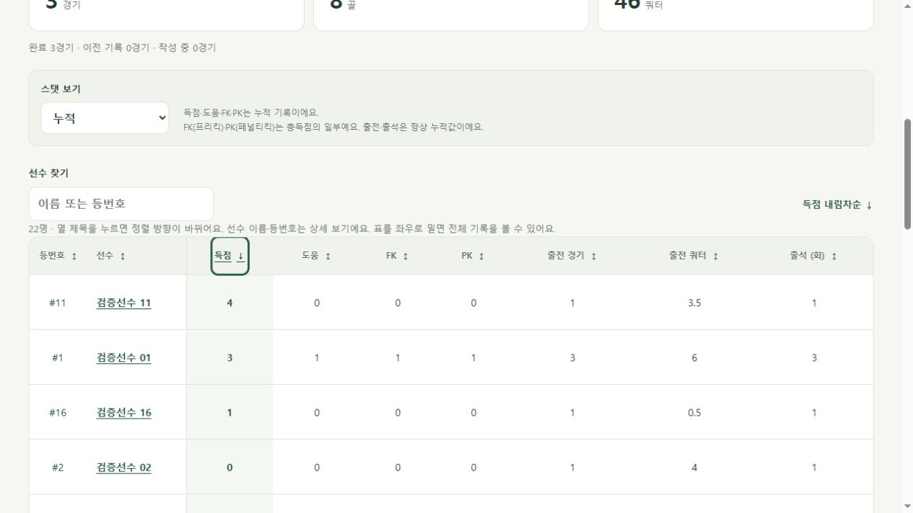

# 연도·월 조회와 선수 기록 표 정렬

2026-10-15 로컬 개발 명세. 운영 앱 `b9d8738`과 가이드 1.1에는 아직 반영하지 않는다.

## 조회 기준과 화면 흐름

| 화면 | 날짜 기준 | 기본값 |
| --- | --- | --- |
| 경기 기록 | 경기 날짜가 선택한 연도·월 안에 있음 | 전체 연도·전체 월 |
| 선수 기록·개인 상세 | 실제 경기 날짜로 범위를 정한 뒤 해당 경기의 골·도움·출전·출석 합산 | 한국 시간 올해·전체 월 |
| 대회 | 대회 시작일~종료일이 선택한 연도·월과 겹침 | 전체 연도·전체 월 |

- 연도에는 현재 연도와 조회 가능한 자료의 연도를 제공한다. 선택 중인 연도도 유지한다. 대회는 시작~종료 사이에 걸친 연도를 포함한다.
- 월은 **전체 월 / 1월~12월**이다. 경기·대회 목록에서 전체 연도를 고르면 월도 전체로 돌아가고 월 선택을 잠근다. 먼저 연도를 고르면 월을 선택할 수 있다.
- 선수 통계는 기존 연간 집계에 월을 더해 좁힌다. 월을 전체로 바꾸면 그해 합계로 돌아간다. 미래 경기 제외, 완료 범위·회원/용병·리그/대회 조건은 그대로 함께 적용한다.
- 대회 기간이 9월20일~10월10일이면 9월과 10월 모두 조회된다. 대회에 연결된 선수 기록은 대회 시작월 대신 실제 경기 날짜로 집계한다.
- 목록의 현재 페이지에만 적용하지 않고 서버에서 기간을 적용한 뒤 페이지를 나눈다. 조건을 바꾸면 첫 페이지로 돌아간다.
- 자료가 없으면 빈 결과를 보여 주되 기간 선택은 유지한다. 연도 목록을 불러오지 못하면 오류·재시도를 안내하며 현재/선택 연도는 유지한다.
- 날짜 필터는 조회 조건이며 저장된 경기 날짜·대회 기간이나 선수 기록을 수정하지 않는다.

스토리보드: **경기 기록 / 선수 기록 / 대회 → 연도 선택 → 전체 월 또는 특정 월 → 기존 경기 구분과 함께 조회**. 선수 상세에서도 같은 기간을 바꿀 수 있고 원본 경기·목록 왕복 시 선택을 유지한다.

[선수 기록 모바일 화면](diagrams/season-period-filter-mobile.png) · [대회 모바일 화면](diagrams/tournament-period-filter-mobile.png). 가상 팀·선수·대회만 사용한 로컬 확인 화면이다.

## 선수 기록 표 정렬

- 기존 정렬 드롭다운 대신 **등번호 / 선수 / 득점 / 도움 / FK / PK / 출전 경기 / 출전 쿼터 / 출석 (회)** 열 제목을 누른다. 등번호와 선수명은 각각 독립된 열이다.
- 새 항목의 첫 클릭은 등번호·이름 오름차순, 숫자 기록 내림차순이다. 같은 항목을 다시 누르면 방향을 반대로 바꾼다. 첫 화면의 득점 내림차순 기본값은 유지한다.
- 현재 항목에 **↑ / ↓**와 강조색, 표 위에 정렬 상태를 표시한다. 제목 버튼은 Enter/Space로도 조작하고 해당 열에 `aria-sort`를 제공한다.
- 누적·1~4쿼터당 보기에서 현재 표시 기준으로 정렬하며 반올림 전 수치를 비교한다. 등번호 미지정과 출전0의 계산 불가 값은 어느 방향에서도 마지막이다.
- 동률은 등번호·이름·식별자 순으로 안정적으로 표시한다. 원본 배열과 조회·집계 결과를 변경하지 않는다.
- 표 본문의 선수 이름·등번호는 개인 상세를 연다. 개인 상세에서 돌아와도 정렬과 검색 조건을 유지한다.
- 모바일에서 등번호·선수 열은 고정하고 나머지 기록은 표 안에서 좌우로 움직인다.

## API·가이드·검증

목록 API의 `year`/`month`는 선택이다. 경기·대회 목록의 월만 지정한 요청, 1~12 밖의 월, 1000~9999 밖의 연도는 거부한다. 통계는 기존 year 생략 시 현재연도 규칙을 유지한다. 기간·팀 권한·다른 조회 조건을 동시에 적용한다. DB 마이그레이션은 필요하지 않다.

회원·운영진 모두 기간 필터·표 정렬 사용법의 가이드 갱신 대상이다. [가이드 대기 목록](guides/maintenance.json)에 기록하고 기능 배포 때 공통 원고·HTML·PDF·앱 안내를 함께 갱신한다. 이번에는 개발 문서와 그림만 갱신한다.

검증은 월말·연말·윤년 경계, 대회 기간 걸침, 목록과 개인 합계 일치, 월 해제, 빈 결과, 팀 격리, 정렬 동률·미지정·쿼터당 분모를 포함한다. 실제 수행 결과와 미검증 범위는 [검증 기록](verification.md)을 따른다.
