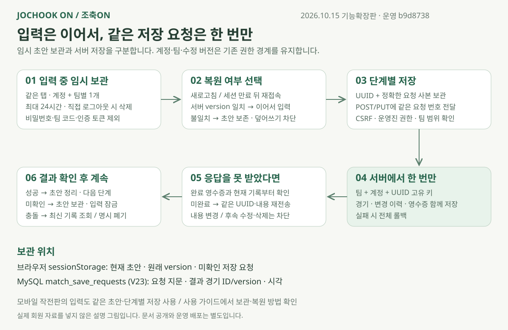
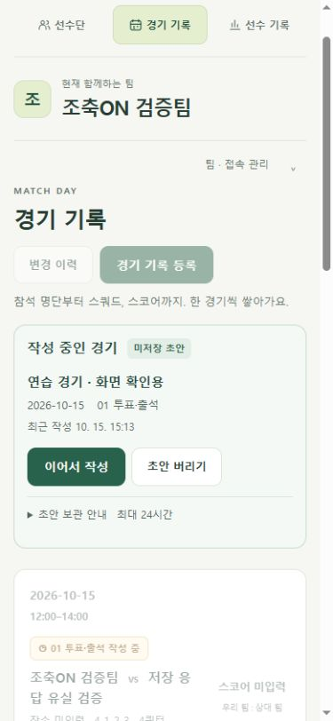

# 경기 초안 복원과 저장 재시도

2026-10-15 기능확장판 `b9d8738`로 운영 반영했다. [배포 검증과 남은 실기기 확인](release-2026-10-15.md).

## 범위와 보관 기준

감독·코치가 입력 중인 경기의 날짜·미완성 시간 선택·투표·출석·배치·실제 출전·골·도움·스코어·코멘트와 현재 단계를 같은 브라우저 탭에 임시 보관한다. 이는 서버 저장과 다르다.

- 저장소는 `sessionStorage`, 계정 사용자명 + 팀 ID별 초안 한 개다. 조회 회원에게는 복원·편집 기능을 제공하지 않는다.
- 마지막 초안 갱신으로부터 최대 24시간 보관한다. 새로고침과 세션 만료 후 같은 탭에서 같은 계정·팀으로 재접속하면 복원 안내를 표시한다. 브라우저의 탭 복구 기능은 브라우저 설정에 따라 다르므로 탭 종료 이후 복원을 보장하지 않는다.
- 직접 로그아웃하거나 회원 코드 접속으로 전환하면 이 계정의 탭 초안을 삭제한다. 자동 세션 만료는 삭제하지 않는다. 다른 계정·팀의 초안을 현재 화면에 표시하거나 자동 저장하지 않는다.
- 비밀번호·팀 코드·인증 토큰은 저장하지 않는다. 경기 초안에 필요한 선수 이름·등번호 등은 이 탭의 저장소에 포함된다. 별도 기기나 다른 브라우저와 동기화하지 않는다.
- 손상·다른 형식·만료된 초안은 복원하지 않는다. 임시 보관에 실패하면 안내하고 화면의 입력은 유지한다. 저장 직전 요청 사본 보관에 실패한 경우 서버로 전송하지 않는다.

## 화면 흐름

1. **입력**: 변경할 때마다 초안을 보관하고 서버에 저장하지 않았음을 표시한다.
2. **돌아오기**: 경기 목록의 ‘작성 중인 경기’에서 경기 정보·입력 단계·최근 작성 시각을 확인한다. ‘이어서 작성’으로 복원하거나 ‘초안 버리기’를 선택한다. 미확인 저장 요청이 있으면 ‘초안 열기’로 결과부터 확인한다. 기존 초안이 있는 동안 새 경기로 덮어쓰지 않는다.
3. **복원**: 현재 서버 기록과 원래 version을 비교한다. 같으면 이어서 입력하고, 다른 운영진의 수정이나 삭제가 있으면 원래 초안을 읽을 수 있게 보존하되 저장을 차단한다. 자동 병합하지 않는다.
4. **단계별 저장**: 고유 UUID와 정확한 요청 내용·기존 ID/version을 초안에 먼저 보관하고 서버로 전송한다. 저장 성공 후 초안을 정리한다.
5. **응답 유실**: 입력을 잠그고 ‘저장 결과 확인·다시 시도’를 제공한다. 완료된 요청이면 해당 경기와 version을 확인하고, 아직 완료되지 않았으면 같은 UUID·같은 내용으로 다시 보낸다. 새 UUID로 자동 재전송하지 않는다.
6. **충돌**: 최신 서버 기록 확인과 명시적인 초안 폐기를 제공한다. 저장 여부 자체를 모르는 동안에는 즉시 폐기하여 새 요청을 만드는 흐름을 막는다.

03의 현재 쿼터·팀과 01~04 단계는 복원한다. 02 작전판의 내부 쿼터 선택은 초기 위치로 돌아가며, 입력한 1~4쿼터 배치 데이터는 모두 보존한다. 저장 결과 조회나 권한 확인의 실패는 기존 UUID를 지우는 근거로 삼지 않는다.

그림 생성 원본: [Generate-DraftRecoveryGuide.mjs](../scripts/Generate-DraftRecoveryGuide.mjs). 화면·API 소스는 아직 로컬에 있으며 설명 그림의 GitHub 업로드와 운영 앱 배포를 구분한다.

### 가상 자료로 확인한 모바일 복원 안내

기본 화면에는 상태·경기 정보·다음 행동만 표시하고, 24시간·로그아웃·탭 종료·다른 경기 열기 규칙은 ‘초안 보관 안내’에서 펼쳐 본다. 날짜·최근 작성 시각을 짧게 표시하고 사용자 화면의 DB·요청·버전 표현을 줄였다. 보관 기간과 실제 저장·충돌 처리는 그대로다.

## 저장 API와 데이터

- POST `/api/v1/matches`, PUT `/api/v1/matches/{id}`에 `Idempotency-Key` UUID 헤더를 보낸다. 기존 클라이언트와의 호환을 위해 서버에서 헤더는 선택적이지만 새 화면은 항상 사용한다.
- `V23__match_save_requests.sql`의 `match_save_requests`는 팀·인증 계정·UUID 조합을 고유 키로 사용한다. 요청 메서드·대상·내용 지문, 저장한 경기 ID·결과 version·시각만 저장한다. 원본 요청 본문과 선수 정보는 저장하지 않는다.
- DB의 고유 키와 트랜잭션 잠금으로 동시 재전송을 직렬 처리한다. 경기·변경 이력·완료 영수증을 같은 트랜잭션에서 저장한다. 실패하면 모두 롤백한다.
- 같은 키의 같은 내용은 기존 결과를 반환하며 경기/이력을 추가하지 않는다. 같은 키로 다른 내용을 보내면 `409 REQUEST_CHANGED`다.
- 해당 결과가 이후 수정·삭제되었다면 `409 SAVE_RESULT_CHANGED`로 막는다. 경기 삭제가 영수증을 제거하지 않아 과거 생성 요청으로 경기를 되살리지 않는다.
- GET `/api/v1/matches/save-requests/{UUID}`는 같은 계정·팀의 `{matchId, version, exists}`만 반환한다. 완료된 요청이 없으면 `404 SAVE_REQUEST_NOT_FOUND`다. 진행 중인 미커밋 요청도 조회되지 않을 수 있으므로 같은 키로 재시도한다. 이 GET은 읽기 전용이다.
- 기존 CSRF, 감독·코치 권한, 팀 범위, 낙관적 잠금(version)을 유지한다. 날짜·상대 팀이 같다는 이유만으로 서로 다른 경기 등록을 막지는 않는다.

## 인수·검증 기준

- 새 경기/기존 경기의 새로고침, 시각 한쪽만 선택, 02/03 수정 후 복원.
- 세션 만료 후 같은 계정·팀 재로그인, 다른 계정·팀/조회 회원에서 복원 비노출, 직접 로그아웃 후 정리.
- HTTP 응답 유실, 동시 같은 UUID 전송, 수정 재전송에서도 경기 한 건과 이력 한 번만 반영.
- 같은 UUID의 다른 내용/다른 대상, 다른 계정·팀, 실패 후 롤백, 저장 결과 이후 수정·삭제.
- 서버 version 변경 시 초안 보존과 저장 차단, 사용자 명시 폐기, 잘못된 저장소/용량 제한/만료 처리.
- 실행한 결과와 미실행 범위는 [검증 기록](verification.md)에 별도 기록한다.

기존 실제 회원 DB나 운영 서비스에 이 기능을 시험 적용하지 않는다. 정식 적용 때는 백업 확인 후 V23을 적용하는 API와 새 웹을 함께 검증한다.

## 이번 실행 결과

Java 단위·MVC 278/278, 가상 네이티브 MySQL 6/6, 프론트 98/98와 JAR·TypeScript/Vite 빌드를 통과했다. 가상 브라우저에서 부분 시간·투표 복원, 단계 저장, 서버 버전 충돌, 직접 로그아웃 정리, 세션 만료 후 재로그인, 저장 성공 후 응답 유실 복구를 확인했다. 응답 복구 시 성공 저장 요청은 한 번이었다.

실제 아이폰 Safari와 Docker 통합 테스트는 이번 실행에서 확인하지 않았다. 편집 중 직접 새로고침은 내장 브라우저의 beforeunload 확인 처리 제약으로 완료하지 못해, 초안 보관 후 목록에서 새로고침한 경로로 확인했다. 운영 서버·실제 선수/경기 자료는 변경하지 않았다.

### 안내 가독성 후속 정리 (2026-10-15 · 로컬)

초안 목록·편집 중 보관·나가기·미확인 저장·충돌 안내의 중복 문장을 줄이고 주요 상태와 보조 규칙을 구분했다. 오류 이유는 해당 안내 안에서 한 번만 표시한다. 모바일 경기 제목의 줄바꿈도 정리했다. TypeScript/Vite 빌드와 기존 프론트 98/98 통과. 가상 브라우저의 320px·390px에서 가로 넘침 없음, 버튼·펼치기 영역 44px 이상, 키보드 Enter 펼치기/접기, 초안 보관 후 이어쓰기 확인. 백엔드·DB·운영 배포는 이번 문구 작업에서 변경하거나 재검증하지 않았다.
