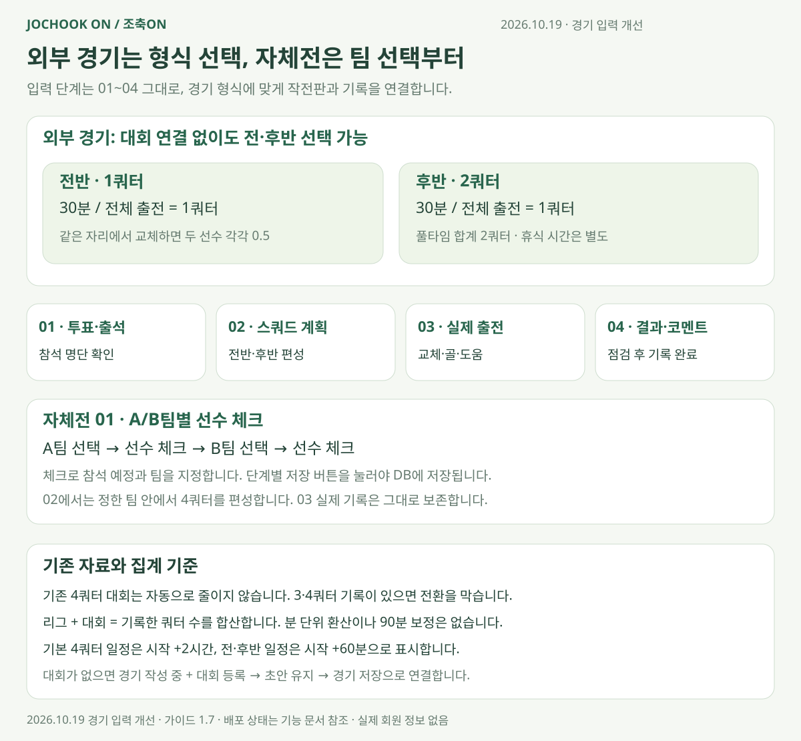

# 경기 중 대회 등록·형식 선택·작전판 자리 교환

2026-10-19 · 배포 검증 중

## 문제와 변경

대회 선택 목록에는 현재 팀에 등록한 대회만 나온다. 대회가 없으면 리그만 보이지만 이유와 등록 동선이 부족했다. 경기 작성 중 **+ 대회 등록**으로 별도 창을 열고 등록한 대회를 바로 선택한다. 상대·날짜·명단 등 경기 초안은 유지한다. 대회 등록 자체는 즉시 저장되며 경기와 연결은 경기 저장 시 반영된다. 목록 새로고침도 제공한다.

외부 경기는 대회 연결과 관계없이 **4쿼터 / 전·후반 각 30분 · 2쿼터**를 선택한다. 자체전은 4쿼터를 유지한다. 3·4쿼터 계획 또는 실제 기록이 있으면 전·후반으로 줄이지 않아 기존 자료를 보호한다. 대회 미연결 외부 경기는 형식과 무관하게 리그로 집계된다.

02 일반 작전판은 배치된 선수 → 다른 자리를 누르면 이동/교환한다. 같은 선수를 다시 누르면 선택을 취소한다. 한눈에 보기에서는 **자리 바꾸기**를 기본으로 선발 두 명을 차례로 눌러 교환하며, **배치·교체 수정**으로 기존 편집창을 연다. 선발 교환 시 교체 선수는 원래 자리에 남는다. 다른 쿼터·자체전 다른 팀·03 실제 기록은 바뀌지 않는다. 변경은 단계별 저장으로 확정한다.

## 스토리보드와 인수 기준

| 화면 | 조작 | 결과 |
| --- | --- | --- |
| 경기 기본 정보 | 대회 없음 → + 대회 등록 | 이름·기간 입력창, 경기 초안 유지 |
| 대회 창 | 필수값 누락 / 정상 등록 | 오류 유지 / 새 대회 선택 후 경기로 복귀 |
| 경기 형식 | 외부 경기에서 전·후반 선택 | 대회 선택 없이 2구간, 시작+60분 |
| 02 일반/한눈에 보기 | 배치된 선발 두 명 선택 | 현재 구간·팀에서 두 선수만 교환 |
| 02 한눈에 보기 | 배치·교체 수정 | 기존 선발·교체 편집창 |
| 저장 | 계획 저장 · 실제 기록으로 | 기존 경기 저장 API 사용 |

[그림 생성 원본](../scripts/Generate-TournamentHalves.mjs). DB/API 계약·권한은 변경하지 않아 ERD와 인프라 구성은 유지한다. 회원 가이드는 형식 설명, 운영진 가이드는 대회 등록·자리 교환을 갱신했다.

## 검증

- 프론트 264개 테스트, TypeScript, 프로덕션 빌드 통과.
- 가상 데이터 브라우저에서 빈 대회 목록, 필수값 오류, 대회 등록·자동 선택·경기 초안 보존, 외부 2구간 선택, 일반 작전판/한눈에 보기 ST↔GK 교환과 기존 교체 편집 확인.
- 단위 테스트로 교체·다른 쿼터·다른 팀 보존 검증.
- 실제 iPhone, 운영 DB 쓰기, 로컬 MySQL 통합 테스트는 실행하지 않음. 백엔드 코드/마이그레이션 변경 없음.

## 배포

운영 웹 배포와 공개 HTTPS·배포 자산 대조 결과는 완료 후 갱신한다.
