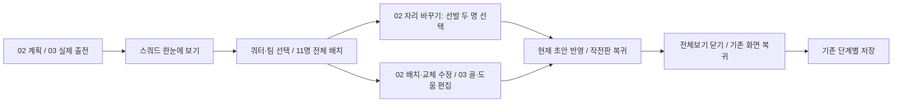
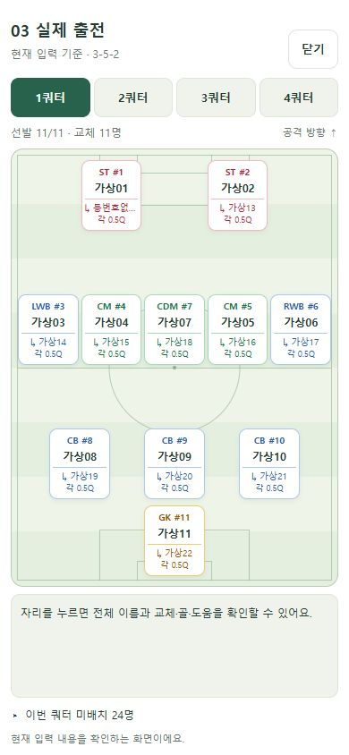
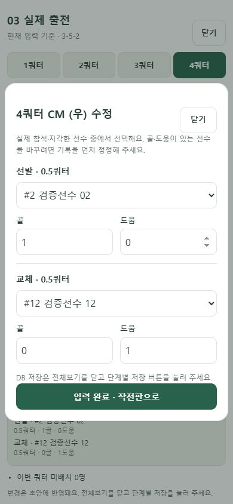
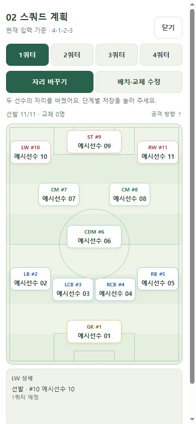

# 모바일 스쿼드 한눈에 보기

2026-10-19 후속 변경(배포 준비): [모드 선택 없이 길게 눌러 이동·교환](pitch-drag-quarter-scores-2026-10-19.md). 아래는 초기 설계 이력입니다.

**운영 반영(2026-10-19):** [경기 입력 3단계 통합](unified-match-entry-2026-10-19.md) · [새 흐름도](diagrams/unified-match/index.html). 웹 `a229bbb` · 가이드 1.8. 현재 입력은 01 참석 → 02 스쿼드·기록 → 03 결과입니다. 아래 이전 날짜의 설명은 당시 이력이며 최신 절차는 통합 문서와 가이드를 따릅니다.

2026-10-15 기능확장판 `b9d8738`로 운영 반영했다. [배포 검증과 남은 실기기 확인](release-2026-10-15.md).

## 목적과 화면 흐름

02 계획·03 실제 출전의 입력 화면에는 설명, 선수 선택, 엑셀 도구, 교체·득점 입력이 함께 있어 휴대폰에서 11명 전체를 보기 어렵다. **스쿼드 한눈에 보기** 버튼으로 전체화면 작전판을 열고 자리를 눌러 수정한다. 기존 단계별 저장 흐름은 유지한다.

1. 02 또는 03의 제목 바로 아래에서 **스쿼드 한눈에 보기**를 누른다.
2. 상단에서 1~4쿼터를 고른다. 자체전은 A/B팀도 선택하며 팀별 포메이션을 따른다.
3. 작전판에는 포지션·등번호·이름을 표시한다. 교체가 있는 자리만 교체 이름과 각 0.5Q를 작게 표시한다.
4. 02는 **자리 바꾸기**에서 선발 두 명을 차례로 눌러 같은 구간·팀 안에서 교환한다. 교체는 원래 자리에 남는다. **배치·교체 수정**으로 작은 편집창을 연다. 03은 자리를 눌러 선발·교체와 골·도움을 수정한다. 조회 회원은 아래 상세 영역에서 전체 이름·교체·기록만 확인한다.
5. 미배치 인원은 아래에서 펼쳐 본다. 자체전에서는 다른 팀에 배치된 선수를 미배치로 세지 않는다.
6. 수정은 기존 초안에 즉시 반영된다. 편집창의 **입력 완료 · 작전판으로** 또는 닫기·ESC는 초안을 유지하며 작전판으로 돌아간다. 취소나 DB 저장을 뜻하지 않는다.
7. 전체보기를 닫고 기존 **계획 저장 · 실제 기록으로** 또는 **출전 기록 저장 · 집계 확인**을 누르면 DB에 저장한다. 전체보기의 쿼터·팀 탐색은 원래 편집 위치를 바꾸지 않는다.

위 열람본은 모든 자리에 교체가 있는 가상 조회 화면이다. 다음은 별도 가상 DB에 연결한 운영진의 편집창이다.

화면 소스는 `frontend/src/features/matches/SquadOverview.tsx`, `OverviewPositionEditor.tsx`, `squad-overview.css`이며 실제 출전 변경 검증은 `appearanceEdit.ts`를 사용한다. 기존 [포메이션 그림](diagrams/formation-guide.svg)과 [그림 생성 소스](../scripts/Generate-FormationGuide.mjs)에도 흐름을 반영했다. 아래 검증 기록은 로컬 개발 당시 결과이며, 최종 운영 반영은 위 배포 기록을 따른다.

## 표시·접근성 기준

- **현재 입력 기준**: 아직 저장하지 않은 내용도 표시한다. 저장 완료 상태로 오해할 문구를 쓰지 않는다.
- 02는 계획, 03은 실제 출전 자료를 별도로 사용한다. 기존 출전 쿼터 계산 함수를 재사용한다.
- 3-5-2는 화면 폭 370px 이상에서 중원 5명을 한 줄로 표시한다. 369px 이하에서는 수비부터 3-2-3-2 형태로 나누며 CDM은 뒤쪽 중앙에 둔다. 이는 전체보기의 화면 좌표만 바꾸며 DB 포지션·자동 편성·실제 출전 기록은 바꾸지 않는다.
- 02는 참석 예정 선수, 03의 새 배치는 실제 참석·지각 선수만 고른다. 자체전의 같은 쿼터에 다른 팀에 배치된 선수는 중복 배치할 수 없다.
- 교체가 있는 선발은 교체부터 해제해야 한다. 03의 골·도움 기록이 있는 선수는 기록을 먼저 0으로 정정해야 바꾸거나 해제할 수 있다. 같은 쿼터 중복 출전과 0~99 정수 범위 밖 기록은 거절하고 초안을 보존한다.
- 작은 카드의 좌·우·중앙 구분은 실제 배치 위치로 보여 주고, 상세 영역과 접근성 이름에는 전체 포지션 이름을 표시한다.
- 카드에서 긴 이름은 말줄임 처리하며 누르면 전체 이름을 읽을 수 있다. 등번호가 없는 선수에게 임의 번호를 만들지 않는다.
- 쿼터 선택·닫기·선수 카드의 터치 높이는 최소 44px이다. 편집창의 입력 글꼴은 16px이다. 기본 dialog의 포커스 제한을 사용하며 편집창의 닫기·ESC는 누른 카드로, 전체보기 닫기는 열기 버튼으로 포커스를 돌려준다.
- 390×844 화면에서는 작전판 전체를 함께 본다. 320×568·가로 화면 등 높이가 부족한 경우 내부 세로 스크롤을 허용하며 카드를 억지로 줄이거나 자르지 않는다.
- 전체보기 자체에는 저장 요청이 없다. 기존 변경 상태·단계별 저장·서버 권한·충돌 처리·API·DB 구조를 재사용한다. 저장 중이거나 편집이 차단된 상태에서는 수정할 수 없다.

## 검증

- TypeScript/Vite 빌드, 프론트 테스트 **76/76** 통과. 추가 12개는 실제 출전 변경의 중복·교체·득점 보호·불변성·타 쿼터/팀 보존 검증이다.
- 초기 조회판에서 6종 × 320/390px, A/B 독립 조회, 빈 명단·긴 이름·등번호 없는 용병을 확인했다. 이번에는 3-5-2의 390px 중원 5명 한 줄과 320px 분리 배치를 모든 자리에 교체가 있는 가상 자료로 확인했다. 카드 겹침·작전판 이탈·가로 넘침 없음.
- 별도 로컬 가상 DB에서 02 자리 교환·교체 추가와 단계 저장, 03 골·도움·교체 추가와 단계 저장, 새로고침 후 저장된 득점·도움 조회를 확인했다. 계획 수정으로 실제 출전이 바뀌지 않고, 전체보기 쿼터 이동으로 원래 편집 쿼터가 바뀌지 않는다.
- 득점·도움이 있는 선수 해제, 교체가 있는 선발 해제를 거절하고 기존 초안을 보존한다. 320px 편집창의 가로 넘침 없음, 닫기·중첩 ESC의 포커스 복귀, 조회 전용 모드에서 편집창 미노출을 확인했다.
- 실제 아이폰 Safari와 백엔드 전체·Docker/MySQL 통합 테스트 묶음은 이번 프론트 변경에서 재실행하지 않았다. 가상 DB 브라우저 저장 검증과 구분한다. 실제 회원·경기 자료와 운영 서버는 변경하지 않았다.

선수 시즌 기록 화면의 필터 접기·요약 행은 후속 검토 사항이며 이번 전체보기 작업에 포함하지 않았다.

2026-10-19 [직접 자리 교환과 배포 기록](match-entry-and-tap-swap-2026-10-19.md).

