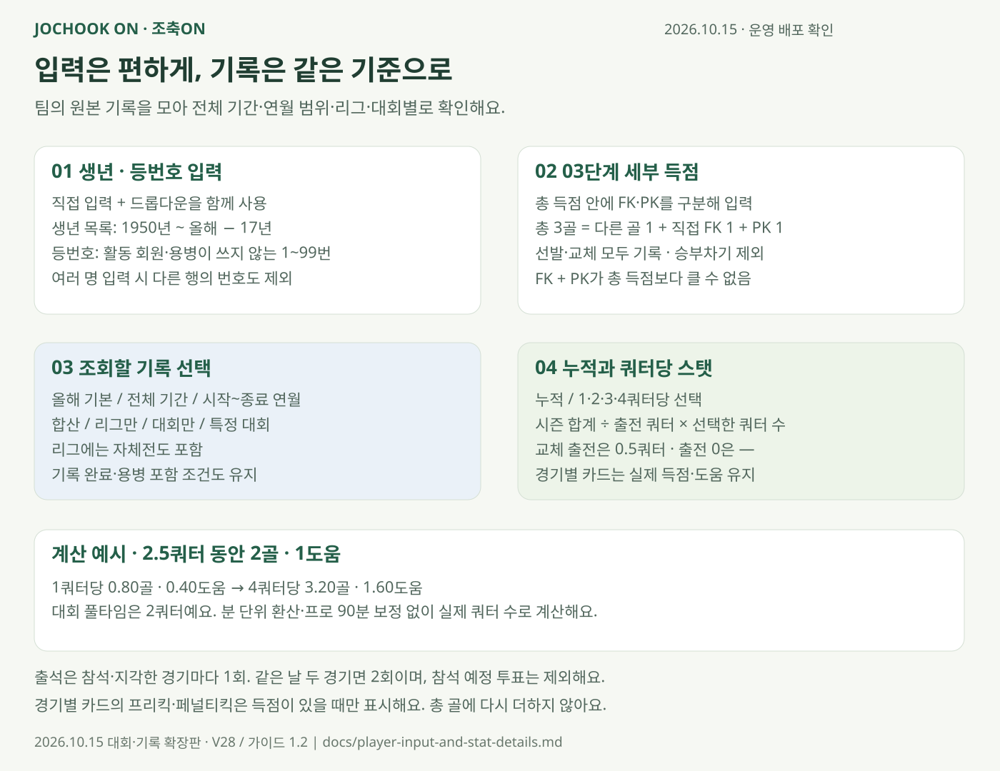

# 선수 입력과 세부 득점·쿼터당 기록

2026-10-15 개발 명세. 로컬 구현 대상이며 운영 앱·가이드 1.1에는 아직 반영하지 않는다. 최종 검증 결과는 [검증 기록](verification.md)을 따른다.

[그림 생성 원본](../scripts/Generate-PlayerStatDetails.mjs) · [생년·등번호 모바일 입력 예시](diagrams/player-input-options-mobile.png)

[03 세부 득점 입력](diagrams/goal-types-mobile.png) · [1쿼터당 개인 기록](diagrams/quarter-rates-mobile.png). 모든 화면은 실제 회원 대신 가상 검증 자료를 사용한다.

[개인 상세의 연도·리그·대회 필터](diagrams/player-season-filters-mobile.png). 상단에는 선택한 범위의 누적/쿼터당 기록, 아래에는 경기별 실제 기록을 표시한다.

## 생년·등번호 입력

- 단일 등록·수정, 여러 선수 등록과 엑셀 미리보기 행에서 직접 입력 칸과 드롭다운을 함께 제공한다.
- 생년 드롭다운은 1950년부터 한국 시간 기준 올해 17세가 되는 출생연도까지다. 2026년에는 1950~2009년이다. 이는 목록 범위이며, 기존 자료와 수기 입력의 1900~올해 허용 범위는 바꾸지 않는다. 미확인으로 비워 둘 수 있다.
- 등번호는 1~99 중 현재 팀의 활동 회원·용병이 사용하지 않는 번호를 보여 준다. 선수 목록의 검색·필터·현재 페이지에 영향을 받지 않는다. 수정 중인 선수 자신은 점유 계산에서 제외한다.
- 여러 행에서 선택·입력한 번호는 다른 행의 선택지에서 제외한다. 행을 삭제하거나 번호를 바꾸면 다시 선택할 수 있다. 중복된 수기 입력을 임의로 지우지 않고 안내하며, 서버가 저장 직전 중복을 다시 검사한다.
- 등번호 조회 중·실패 시 드롭다운을 잠그고 직접 입력과 다시 불러오기를 제공한다. 확인하지 못한 번호를 남는 번호로 안내하지 않는다.

스토리보드: 선수단 → 선수 등록 또는 여러 명 등록 → 생년을 입력/선택 → 남는 등번호를 입력/선택 → 기존 검토·저장. 등록 화면을 여는 것만으로 데이터는 저장되지 않는다.

## 출석과 출전 구분

사용자가 같은 날짜라도 경기마다 1회로 집계하기로 결정했다. **출석 (회)** 열 제목은 기존 `attendances` 값으로 양방향 정렬한다. 참석·지각으로 표시된 경기만 세며, 실제 출전하지 않아도 포함한다. 참석 예정 투표는 제외한다. 날짜를 중복 제거한 출석 일수가 아니므로 표·개인 합계는 횟수로 표시한다.

실제로 뛴 경기 수인 `appearances`는 **출전 경기**, 참석·지각한 횟수는 **출석 (회)**로 구분한다. 후속 열 제목 정렬에서는 두 열을 각각 정렬할 수 있다. 출석률·시상 정책은 별도다. [연도·월 조회와 표 정렬](date-filters-and-table-sorting.md).

## 프리킥·페널티킥 득점

- 03 실제 출전에서 선발과 교체 선수 각각 총 득점·도움·직접 프리킥 골·경기 중 페널티킥 골을 기록한다. 승부차기는 제외한다.
- FK·PK는 총 득점에 포함된 부분집합이다. 예: 총 3골, FK 1골, PK 1골이면 다른 골은 1골이다. `FK + PK <= 총 득점`, 각 수치는 0~99 정수다. FK·PK를 총 득점에 다시 더하지 않는다.
- 한눈에 보기에서는 선수를 눌러 상세 편집에서 입력한다. 실제 출전·쿼터 배분과 교체 0.5 계산은 바꾸지 않는다.
- 시즌/대회 집계·개인 상세·04 집계·변경 이력에 같은 값을 연결한다. 기존 기록은 세부 득점 0으로 시작한다. 구버전 요청에서 세부 필드를 생략하면 기존 선수·쿼터의 값을 보존하며 명시적 0만 지운다.
- 새 V25에서 출전 기록에 두 컬럼을 추가한다. 적용된 마이그레이션은 수정하지 않는다. 예전 엑셀 양식도 계속 읽고, 새 양식에는 FK·PK 열을 끝에 덧붙인다. 누락과 명시적 0의 차이는 초안·재시도·엑셀 처리에도 유지한다.

스토리보드: 경기 기록 → 03 → 선수 상세 → 총 골/도움/FK/PK → 단계 저장 → 04 합계 확인 → 선수 기록 → 연도·리그/대회 선택 → 개인 상세와 원본 확인.

## 1~4쿼터당 기록과 경기별 실제 기록

- 보기 선택은 **누적 / 1쿼터당 / 2쿼터당 / 3쿼터당 / 4쿼터당**이다. 기본은 누적이며 개인 상세를 왕복해도 선택이 유지된다.
- N쿼터당 = 선택 범위의 스탯 합계 ÷ 실제 출전 쿼터 합계 × N. 시즌 목록과 개인 상단 합계의 총 골·도움·FK·PK에 적용한다.
- 예: 2.5쿼터 동안 2골·1도움이면 1쿼터당 0.80골·0.40도움, 4쿼터당 3.20골·1.60도움이다. 경기별 평균을 다시 평균 내지 않는다.
- 출전 쿼터가 0이면 평균을 `—`로 표시한다. 소수점 둘째 자리 표시는 마지막에만 반올림하고 정렬은 반올림 전 값으로 계산한다. 출전 경기·출전 쿼터·출석은 계속 누적값이다.
- 연도·월과 리그/대회/특정 대회, 완료 범위, 용병 조건을 먼저 적용하고 계산한다. 전체 월이면 해당 연도 전체다.
- 목록과 개인 상세에서 같은 연도·경기 구분을 직접 변경할 수 있다. 자체전은 리그에 포함하고 기본 합산에도 포함한다. 경기별 배지는 자체전으로 유지한다. 조건 변경 시 상세 첫 페이지부터 조회하고 원본·목록 왕복에도 최신 조건을 유지한다.
- **개인 상세 아래 경기별 기록은 보기 선택과 관계없이 해당 경기의 실제 득점·도움 정수만 표시한다.** 프리킥·페널티킥은 각각 1골 이상일 때만 전체 이름과 골 수를 덧붙인다. 0 또는 예전 응답의 누락값은 해당 세부 문구를 표시하지 않는다. 실제 출전 쿼터·출석·원본 연결은 유지한다.
- **4쿼터를 실제 1경기 또는 프로 90분으로 환산하지 않는다.** 쿼터 길이도 추가 저장하지 않는다. 프로 선수 비교는 나중에 별도 기능으로 설계한다.

## 가이드 갱신과 검증

운영진용 가이드는 생년·등번호 입력, FK/PK 입력·저장·엑셀 양식이 갱신 대상이다. 회원용·운영진용 모두 출석 단위와 누적/쿼터당 기록 설명을 갱신한다. 미배포 변경은 [가이드 반영 대기 목록](guides/maintenance.json)에 기록하고 실제 기능 배포와 함께 원고·HTML·PDF·앱 가이드를 갱신한다.

입력 경계·가용 등번호의 전체 팀 조회·다중 행 중복·0.5쿼터·0분모·범위별 합산·FK/PK 부분합·과거 요청 및 저장 영수증 호환·초안/엑셀/이력·작은 화면을 가상 자료로 확인한다. 실제 회원 자료로 시험 저장하지 않는다.

최신 로컬 Java 단위/API 352개, 프론트 177개, 격리 native MySQL 대회/리그 통합 13개와 빌드를 통과했다. 이전 FK/PK 전용 native 검증은 5개 통과했다. Docker 전체 통합은 FK/PK 추가 전 127개 통과했으나, 추가 후 재실행은 엔진 응답 지연으로 중단했다. 실제 아이폰 Safari와 최신 전체 Docker 회귀는 후속 확인 대상이다.
