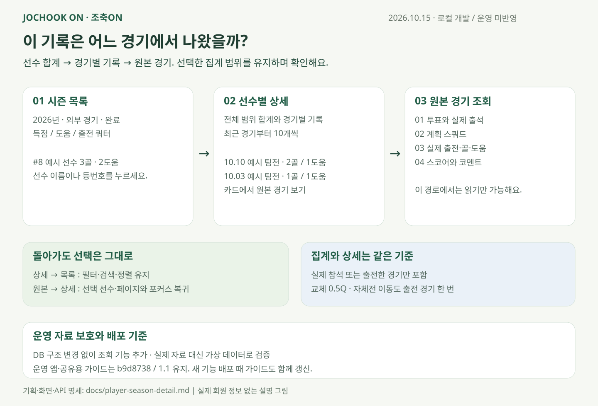
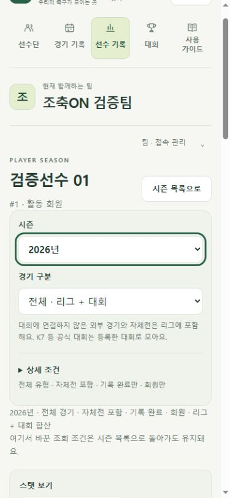

# 선수별 시즌 상세와 원본 경기

2026-10-15 로컬 개발 범위. 현재 운영 앱은 `b9d8738`이며 이 기능의 운영 배포는 별도 확인한다.

## 목적과 범위

시즌 합계만으로는 어느 경기의 기록인지 대조하기 어렵다. 선수 기록에서 이름·등번호를 눌러 개인 합계와 경기별 기록을 확인하고 원본 경기의 투표·출석·스쿼드·결과를 읽는다. 회원과 감독·코치 모두 같은 조회 흐름을 사용한다.

- 시즌 목록에서 선택한 시작 연월~종료 연월 또는 전체 기간·경기 유형·리그/대회·기록 범위·용병 포함 조건을 상세에도 그대로 적용한다. 상세에서도 기간을 바꾸고 조회할 수 있으며 목록으로 돌아가도 적용한 조건을 유지한다. 리그는 자체전을 포함한다. 기본값은 올해1월~12월이고 **전체 기간**은 모든 과거 연도부터 오늘까지, **올해**는 현재 연도로 즉시 전환한다.
- 개인 요약은 해당 범위 전체의 득점·도움·출전 경기·출전 쿼터·실제 참석이다. 현재 상세 페이지의 합계가 아니다.
- 상세에는 참석/지각 또는 실제 출전이 있는 경기만 표시한다. 참석했지만 뛰지 않은 경기는 출전 0으로 구분한다.
- 경기별 카드는 날짜·시간·상대/자체전·스코어·작성 상태와 해당 선수의 실제 득점·도움·쿼터·출석을 보여 준다. 상단 누적/1~4쿼터당 선택과 관계없이 원래 득점·도움을 표시하며 프리킥·페널티킥은 각 값이 양수일 때만 표시한다. 경기 날짜 내림차순, 같은 날짜는 등록 ID 내림차순으로 10개씩 조회한다. 조건 변경 시 첫 페이지로 돌아간다.
- 원본 경기는 읽기 전용으로 연다. 이 화면에서 경기 저장·삭제·초안 교체를 수행하지 않는다. 수정은 기존 경기 기록 메뉴를 이용한다.
- 상세에서 목록으로 돌아오면 필터·검색·정렬을, 원본에서 상세로 돌아오면 선택 선수와 상세 페이지를 유지한다. 브라우저 재시작까지 보관하거나 공유용 상세 주소를 제공하는 범위는 아니다.

## 화면 흐름

1. **선수 기록**에서 원하는 범위를 고른다. 표의 열 제목은 양방향 정렬, 본문의 선수 이름·등번호는 개인 상세다.
2. 상세 상단에서 시작 연월·종료 연월을 고른 뒤 조회하거나 경기 구분·누적/1~4쿼터당 보기를 선택한다. 경기별 실제 카드를 읽고 필요하면 이전/다음 페이지를 선택한다.
3. 카드의 **원본 경기 보기**를 눌러 저장된 01~04 내용을 확인한다.
4. **선수 기록으로**를 눌러 같은 선수의 상세로 돌아간다.
5. **시즌 목록으로**를 눌러 원래 목록으로 돌아간다.

[그림 생성 원본](../scripts/Generate-PlayerSeasonDetailGuide.mjs). 그림은 가상의 예시이며 실제 팀 자료를 포함하지 않는다.

## 집계·권한 계약

기존 [시즌 기록 기준](player-stats-and-formations.md) 중 이번 로컬 기본 범위는 완료된 리그+대회(자체전 포함)·회원으로 변경한다. 한국 시간 오늘 이후 경기와 계획은 제외한다. 교체된 같은 자리의 두 선수는 각 0.5쿼터, 자체전 A/B 이동은 같은 경기 한 번으로 센다. 상대 자책골 등의 팀 스코어 차이는 선수 개인 득점에 더하지 않는다. 출석률·시상·동률 정책을 새로 정하지 않는다.

`GET /api/v1/stats/players/{playerId}/matches`는 기존 통계 필터와 `page`를 받는다. 페이지는 0부터 시작하며 크기는 10으로 고정한다. 응답의 `player`는 전체 범위 요약, `items`는 현재 페이지이고, `totalElements`·`totalPages`를 함께 돌려준다. 이 API는 현재 세션 팀의 회원·감독·코치에게만 열려 있다.

DB 테이블이나 저장 필드는 추가하지 않는다. 공통 경기 범위·출석·실제 출전 쿼리를 재사용해 목록과 상세의 집계가 달라지지 않게 한다. 교체 인원 계산을 마친 뒤 선수별로 추려야 교체 상대가 용병이어도 각 0.5쿼터를 유지한다.

시작 시각은 원본 경기와 같은 JPA 매핑을 사용한다. 기존 `hibernate.jdbc.time_zone=UTC` 환경에서 JDBC로 TIME 원문을 읽으면 원본 화면과 다른 시각이 될 수 있기 때문이다. DB에서 추린 현재 페이지의 경기 ID에 대해서만 팀 범위를 확인해 한 번에 읽으며, 기존 저장값이나 시간대 설정은 변경하지 않는다.

## 예외와 인수 기준

- 활동 중인 회원의 기록이 없으면 0 요약과 빈 목록을 보여 준다. 비활동·용병 포함 기준은 기존 시즌 목록과 같다.
- 없는 선수, 다른 팀 선수, 현재 조건에서 제외된 선수는 같은 404 응답을 사용한다. 존재 여부를 구분해 노출하지 않는다.
- 불러오는 중·네트워크 오류·재시도·세션 만료를 구분한다. 빠르게 다른 선수를 선택하거나 이동한 뒤 도착한 이전 응답은 화면에 반영하지 않는다.
- 삭제된 원본은 조회할 수 없다는 안내와 복귀/재시도 동작을 제공한다. 수정·삭제 이후 새 조회는 현재 DB 상태를 기준으로 한다.
- 합계와 모든 상세 페이지를 합산한 기록이 같아야 한다. 참석만 한 경기·자체전·교체·용병·이전 기록·미래 경기·페이지 경계를 가상 데이터로 검증한다.
- 320/390px 화면에서 페이지 자체 가로 넘침 없이 읽을 수 있어야 한다. 목록과 상세로 복귀할 때 누른 버튼에 포커스를 돌려준다.

## 사용자 가이드 영향

회원용과 운영진용 모두 선수 기록 항목에 상세·원본 경기·복귀 흐름을 추가할 대상이다. 운영 가이드 1.1의 본문·PDF는 배포판 기준을 유지하고 [갱신 대기 목록](guides/maintenance.json)에 이번 변경을 기록한다. 기능 배포를 준비할 때 공통 원고·HTML·PDF·앱 가이드를 함께 갱신하고 실제 버튼과 다시 대조한다.

후속 [연도·월 조회와 표 정렬](date-filters-and-table-sorting.md)을 함께 적용한다. 실제 아이폰 확인·최신 전체 Docker 통합·운영 배포는 남아 있다. 이전 상세 기능과 후속 변경의 실제 수행 결과를 구분해 [검증 기록](verification.md)에 남긴다.

## 로컬 모바일 확인 화면

가상 검증팀·가상 선수의 화면이다. 개인 상세에 연도·경기 구분 선택을 추가하고 상세 조건을 접어 두었다. 실제 팀의 기록이나 계정 정보가 아니다.

