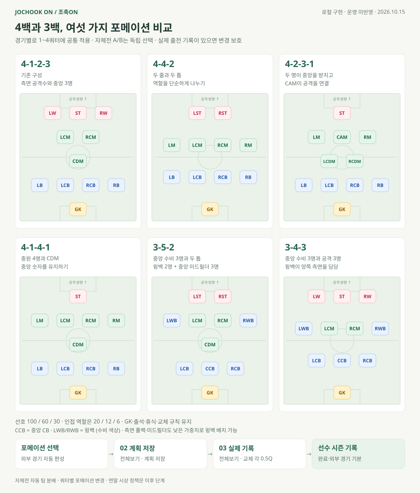
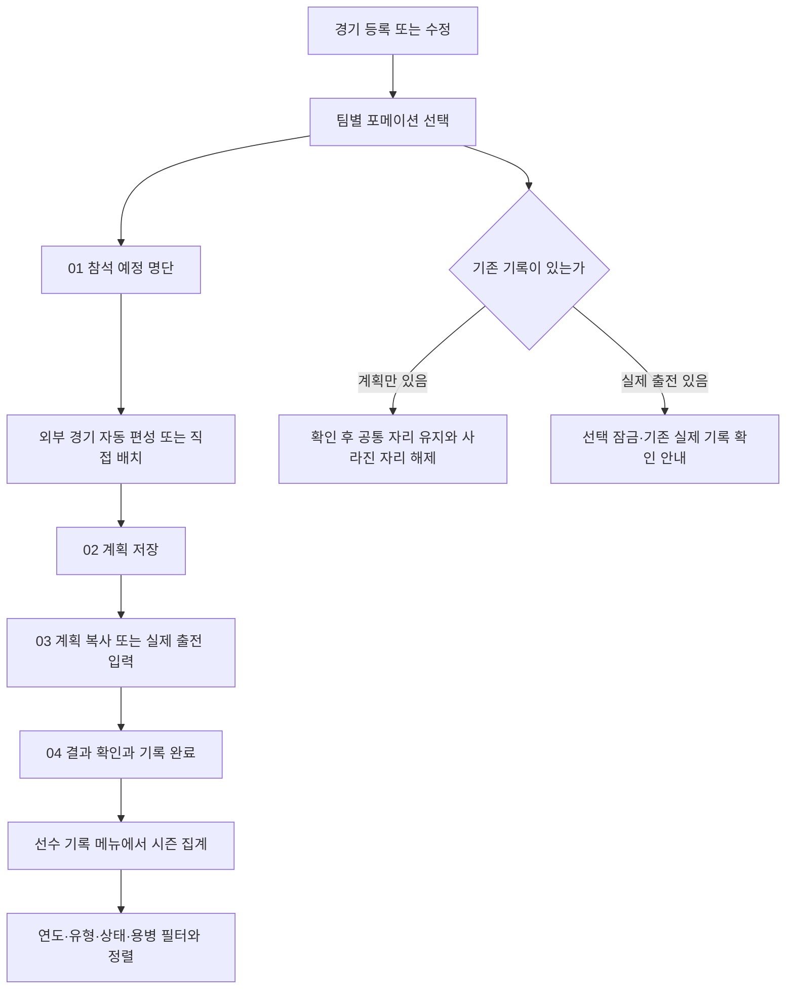

# 선수 시즌 기록과 포메이션 확장

2026-10-15 로컬 구현. 운영 서버 `dd67f92`에는 아직 반영하지 않는다. 감독·코치의 경기 기록을 회원이 시즌 단위로 볼 수 있게 하고, 같은 선수 명단으로 네 가지 4백 포메이션을 계획한다.

## 선수 기록 화면

주요 메뉴의 **선수 기록**에서 시즌 연도, 경기 유형, 작성 상태, 용병 포함 여부를 고른다. 기본값은 한국 시간 현재 연도·기록 완료된 외부 경기·회원이다. 이는 조회 필터의 기본값이며 연말 시상 자격 규칙을 확정한 것은 아니다.

| 항목 | 계산 기준 |
| --- | --- |
| 득점·도움 | 03 실제 출전 행의 합계. 직접 입력한 팀 스코어와 별개 |
| 출전 경기 | 실제 출전 행이 있는 경기 수. 여러 쿼터·자체전 A/B 이동을 중복 계산하지 않음 |
| 출전 쿼터 | 같은 경기·쿼터·팀·자리에 선발만 있으면 1, 선발과 교체가 있으면 각각 0.5 |
| 실제 참석 | PRESENT·LATE로 기록한 경기 수. 투표 참석 예정과 구분, 출전하지 않아도 참석 인정 |
| 집계 경기 수 | 선택한 경기 범위의 수. 용병 포함 여부·선수 검색으로 바뀌지 않음 |

한국 시간 오늘 이후의 경기는 제외하며 계획 배치는 어떤 필터에서도 집계하지 않는다. 활동 회원은 0건도 표시한다. 비활동 회원과 포함을 선택한 용병은 해당 범위의 실제 참석·출전이 있는 경우 표시한다. 등번호가 없는 용병은 임의 번호를 붙이지 않는다. 이름·등번호는 현재 선수 프로필이다.

작성 상태 필터는 다음과 같다.

- **기록 완료만**: 운영진이 완료 버튼을 누른 `COMPLETED` 경기.
- **완료 + 이전 기록**: 완료 경기와 작성 상태 도입 이전의 NULL 경기. 이전 기록을 완료로 변경하지 않는다.
- **작성 중 포함**: 위 기록과 중간 저장한 경기. 합계가 변할 수 있다는 안내를 표시한다.

득점·도움·출전 경기·출전 쿼터·실제 참석 내림차순, 등번호·이름 오름차순 정렬을 제공한다. 동률은 등번호(NULL 마지막), 이름, ID 순으로 안정적으로 표시하며 시상 순위 번호는 부여하지 않는다. 실제 참석률의 분모, 시즌 시상 자격·동률 처리, 자체전 시상 포함 여부는 후속 정책이다. 기존 자동 편성의 출석률 계산은 변경하지 않는다.

통계는 집계 테이블 없이 원본에서 조회한다. 기록 수정·삭제와 완료 상태 변경은 새로고침이나 메뉴 재진입 시 반영된다. 출전과 출석을 따로 집계해 조인으로 득점이 곱해지는 오류를 방지한다.

## 포메이션 선택

그림 원본은 [Generate-FormationGuide.mjs](../scripts/Generate-FormationGuide.mjs)이며 `node scripts/Generate-FormationGuide.mjs`로 다시 생성한다.

| 포메이션 | 자리 구성과 첫 사용 목적 |
| --- | --- |
| 4-1-2-3 | 기존 구성. CDM 1명, CM 2명, LW·ST·RW |
| 4-4-2 | LM·CM·CM·RM과 ST 2명. 두 줄과 두 톱의 역할을 나눠 보기 좋음 |
| 4-2-3-1 | CDM 2명, LM·CAM·RM, ST 1명. 중앙을 받쳐 주고 공격 연결 역할을 구분 |
| 4-1-4-1 | CDM 1명, LM·CM·CM·RM, ST 1명. 중원 숫자를 유지하는 구성 |

4백을 유지하면 기존 수비 배치에서 미드필더·공격수 구성을 비교하기 쉬워 이 네 종류부터 시작한다. 4-4-2의 두 줄 수비 설명은 [FIFA Training Centre](https://www.fifatrainingcentre.com/en/game/game-analysis/out-of-possession/team-organisation--out-of-possession-.php)를 참고했고, 위 도입 순서는 우리 앱의 기존 구조와 사용 흐름에 따른 선택이다. 3-5-2·3-4-3과 윙백은 다음 확장이다.

경기당 팀별 한 포메이션을 선택해 1~4쿼터에 공통 적용한다. 자체전은 A팀·B팀이 각각 다른 포메이션을 고를 수 있다. 자체전의 자동 팀 분배는 아직 제공하지 않고 직접 배치한다. 외부 경기 자동 편성은 선택 포메이션의 GK 1자리·필드 10자리를 사용한다.

선수의 선호 선택지에 **LM·RM·CAM**을 추가하며 모두 미드필더 색상·그룹으로 분류한다. 기존 선호는 그대로 보존한다. 같은 역할의 좌우 자리(CB·CM·CDM·ST)는 같은 선호 점수를 받는다. 정확한 1·2·3지망은 100/60/30, 인접 역할 `LW↔LM`, `RW↔RM`, `CM↔CAM`은 20/12/6점이다. 인접 역할은 정확한 3지망보다 낮고, 비선호 배치 수에 포함하여 안내한다. GK 그룹, 연속 두 쿼터 휴식 금지, 출석 우선권, 앞 3쿼터 교체 최소화 규칙은 유지한다.

## 화면 흐름과 보호 규칙

1. 경기 기본 정보에서 포메이션을 고른다. 기존 경기는 4-1-2-3으로 열린다.
2. 계획이 있는 상태에서 변경하면 확인 영역을 표시한다. 공통 자리는 선발·교체 모두 유지하고 사라진 자리의 해제 건수를 보여 준다. 취소하면 기존 초안을 유지한다.
3. 해당 팀에 실제 출전 행이 하나라도 있으면 선택을 잠근다. 기록이 0골이어도 보호하며, 운영진이 03에서 기존 배치를 직접 확인·해제한 뒤 바꿀 수 있다.
4. 엑셀 양식·검토는 현재 선택한 팀의 포메이션으로 진행한다. 없는 포지션은 행 오류로 표시하고 팀 단위 기존 반영 규칙을 유지한다.
5. 경기 목록·조회·변경 이력에 포메이션을 표시한다. 예전 변경 이력 JSON의 누락 필드는 4-1-2-3으로 해석한다.
6. 선수 기록은 조회 회원에게도 제공한다. 접속 만료·다른 팀 전환 시 이전 응답을 버리고 기존 팀 보안 흐름을 따른다. 실패·빈 시즌·선수 검색 결과 없음도 표시한다.

## API와 DB

- `GET /api/v1/stats/players?year=2026&kind=EXTERNAL&recordScope=COMPLETED&includeGuests=false`
- `kind`: EXTERNAL / INTERNAL / ALL. `recordScope`: COMPLETED / RECORDED / ALL. 연도 1000~9999.
- 응답: 필터, availableYears, matchCount·completedMatchCount·legacyMatchCount·inProgressMatchCount, items의 선수 식별·득점·도움·출전·참석·쿼터. 회원·감독·코치 권한과 `X-Team-Id`를 검증한다.
- 경기 요청·응답에 `formationA`, `formationB`: F4123 / F442 / F4231 / F4141. 신규 생략은 F4123, 수정 요청 생략은 기존 값을 보존한다. 외부 B는 F4123으로 유지한다.
- 자동 편성 요청·응답의 `formation`, 경기 엑셀 template/preview의 `formation` 쿼리는 F4123 기본값.
- V21에서 match_records의 formation_a/b, 허용 값 CHECK를 추가하고, 계획·출전 slot을 VARCHAR(4)로 넓힌다. 선호 CHECK에 LM/RM/CAM을 추가한다. 기존 마이그레이션과 실제 선수 자료는 수정하지 않는다.

운영 적용 전에는 백업을 확인하고 API V21·웹 버전을 함께 배포해야 한다. 새 웹을 V20 API에 연결하여 사용하는 것은 검증 환경이 아니다. 이번 확인은 가상 자료의 별도 로컬 환경에서 진행한다. 실행 결과는 [검증 기록](verification.md)에 남긴다.

## 이번 검증 결과

Java 단위·MVC 246개, 프론트 60개, 격리된 Windows MySQL 8.4.11 통합 46개를 통과했다. TypeScript/Vite·bootJar 빌드와 320px·390px·데스크톱 화면을 확인했다. Docker 엔진 시작 실패로 Testcontainers 실행은 못 했고, 실제 아이폰 Safari와 운영 서버 검증은 배포 이후에 수행한다. 별도 QA DB의 5골·4도움·44쿼터, 교체 3.5·0.5Q를 실제 화면에서 확인했다. 실제 회원·경기 자료와 운영 버전은 변경하지 않았다.