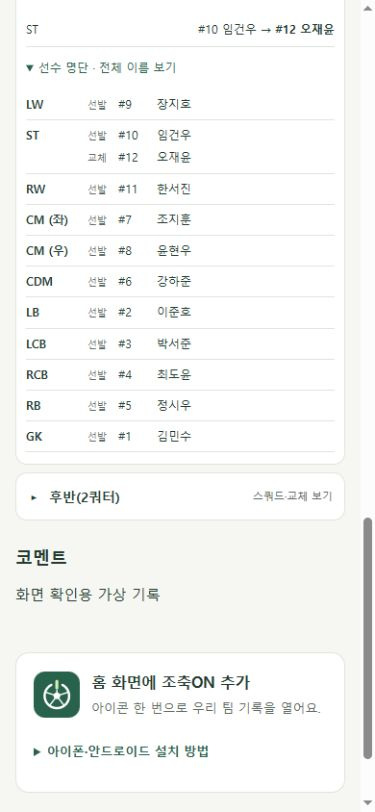
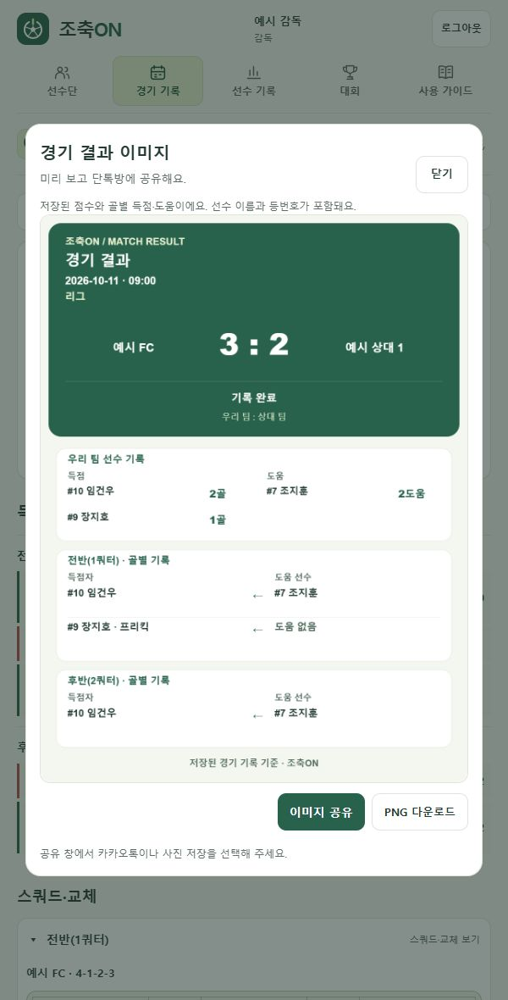

# 선수 명단 정렬·결과 이미지 골별 도움 — 로컬 미리보기

## 운영 반영

2026-10-21 21:19:06 KST · 웹 `a05b872510fdfc68056f6ac3c17449d295e500ab` · Northflank `open-nose-7278` 배포 완료. API `b6f722a61359487f817334094c38a8a8f3a6e400`·DB V34 유지. [GitHub CI](https://github.com/ksmlucky/jochook-on/actions/runs/39597048437) 전체 성공. 프론트321개·공개 HTTPS9개·인증 점검14개·JS/CSS/PDF4개 바이트 일치 확인. 운영 자료 쓰기와 외부 메시지 전송 없음.

아래는 배포 전 설계·검증 이력이다. 가이드1.20도 함께 반영했다.

2026-10-21 · 미배포. 가상 팀·선수로 촬영한 실제 브라우저 캡처다.

## 기능과 화면 흐름

- 경기 결과 → 스쿼드·교체 → 전체 이름 보기: 포지션 / 선발·교체 / 등번호 / 이름을 열로 정렬한다. 선발과 교체 행의 번호 및 이름 시작 위치는 동일하다. 번호 없음은 —, 긴 이름은 줄바꿈한다.
- 경기 결과 → 결과 이미지: 기존 선수별 합계 아래 구간별 골 기록을 추가한다. 한 행의 득점자 ← 도움 선수가 한 골을 나타낸다. 전·후반/쿼터 이름, 자체전 A·B팀, FK·PK 구분을 유지한다.
- goalEvents가 있는 구간만 연결을 표시한다. 도움 null은 도움 없음, 참조 선수가 없으면 선수 미확인. 과거 합계만 있는 구간은 합계를 유지하고 골·도움 연결 미기록을 표시한다. 실제 득실점 시간순이라는 의미는 부여하지 않는다.
- 최대 16개 골 및 이미지 높이 예산 안에서 골별 행을 표시하고, 생략된 골 수를 안내한다. 최종 점수 불일치·작성 중·미입력 경고는 유지한다.
- 새 서버 요청·API·DB 변경이나 운영 자료 수정은 없다.

## 화면 및 원본

- [명단 렌더 원본](../frontend/src/features/matches/MatchReport.tsx) · [스타일](../frontend/src/features/matches/match-report.css)
- [이미지 생성 원본](../frontend/src/features/matches/matchResultImage.ts) · [공유 창](../frontend/src/features/matches/MatchResultImageShare.tsx)
- 앞선 [등번호 스쿼드 미리보기](squad-number-preview-2026-10-21.md)와 함께 로컬 변경으로 관리한다.

## 검증과 가이드 영향

TypeScript/Vite 빌드 성공. 기존 번들 크기 경고는 남아 있다. 프론트 회귀 321개 통과(서로 다른 도움 연결·도움 없음·구간별 예전 합계·4쿼터 순서·긴 이름·자체전·행 생략 및 이미지 높이 검증 포함).

브라우저에서 390px/320px 명단의 번호·이름 x좌표가 모든 선발·교체 행에 동일함을 확인했다. 가로 넘침 없음. 공유 PNG 생성 및 320px 공유 창 가로 넘침 없음을 확인했다. 가상 전후반 경기의 공유 PNG는 1080×1434이다.

실제 iPhone/Safari 공유, 외부 전송, 백엔드/MySQL 통합 검증, 배포는 실행하지 않았다. 회원·운영진 모두 같은 조회·공유 기능이므로 양쪽 가이드 대상이다. 배포 전에는 운영 가이드 1.19를 유지하고, 배포 시 골별 연결 및 예전 합계의 제한 설명을 함께 검토한다. 권한·DB·업무 동선 그림은 구조 변경이 없으며 변경된 화면 캡처와 생성 원본은 이 문서에 연결했다.