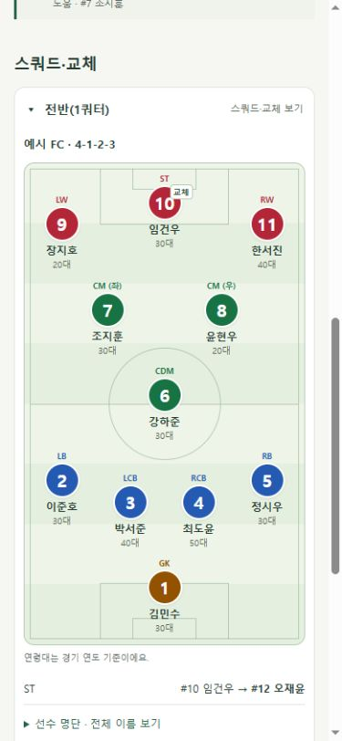

# 스쿼드 등번호 보기 — 로컬 미리보기

2026-10-21 · 미배포. 운영 가이드 1.19 및 운영 앱에는 아직 반영하지 않았다.

## 표시와 화면 흐름

경기 목록 → 경기 결과 → 스쿼드·교체 → 첫 구간의 작전판.
포지션 색상의 원형 등번호 아래에 이름, 더 작은 연령대를 표시한다. 11개 자리의 크기는 동일하다. 긴 이름은 한 줄로 줄이고 기존 전체 명단에서 확인한다. 교체가 있으면 번호 옆에 ‘교체’를 표시하고 작전판 아래에 선발 → 교체 선수 이름을 유지한다.

연령대는 기존 ageBand 함수와 경기 연도를 사용한다. 번호가 없으면 —, 생년이 없거나 유효하지 않으면 연령대 미확인으로 표시한다. 미배치 자리에는 이름·나이를 만들어 넣지 않는다.

02 편집 작전판, 저장 데이터, API, DB, 권한, 이미지 공유 기능은 변경하지 않았다. 기존 운영 흐름도는 그대로 유지하며 이 문서와 캡처는 배포 전 변경을 별도로 보여 준다. 운영진·회원 모두 같은 조회 UI를 사용한다. 배포 시 두 역할의 가이드에 이 표시 방식이 필요한지 다시 확인한다.

## 렌더 원본과 캡처

- 원본: [MatchReport.tsx](../frontend/src/features/matches/MatchReport.tsx), [match-report.css](../frontend/src/features/matches/match-report.css)
- 390px 모바일 실제 브라우저 캡처. 팀·선수·경기는 모두 가상 데이터다.

## 검증

- TypeScript/Vite 빌드 성공. 기존 번들 크기 경고는 유지.
- 프론트 회귀 테스트 319개 통과.
- 320px·390px × 6개 포메이션: 각 11개 동일 크기, 카드 겹침·작전판 밖 넘침 없음.
- 390px 실제 렌더에서 원형 배지, 이름·작은 연령대, 교체 표시와 명단 확인.
- 실제 iPhone Safari, 백엔드/MySQL 통합 테스트, 운영 배포는 이번 작업에서 수행하지 않음.