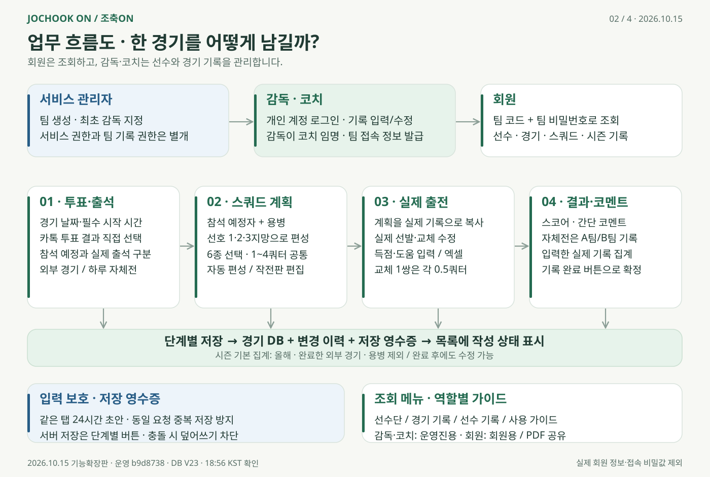
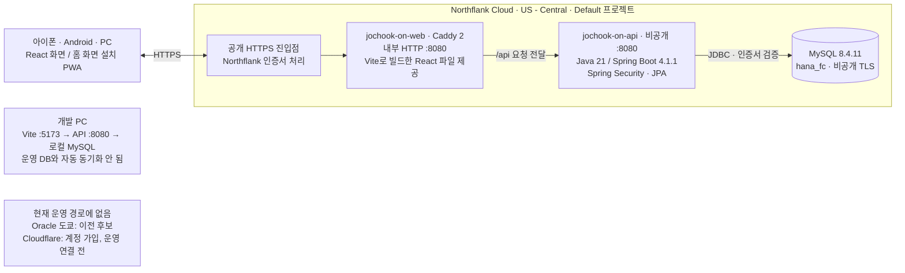
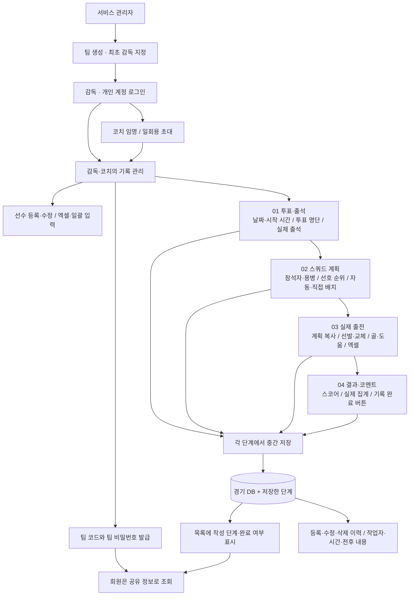
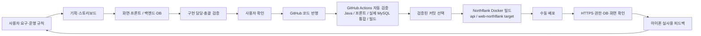
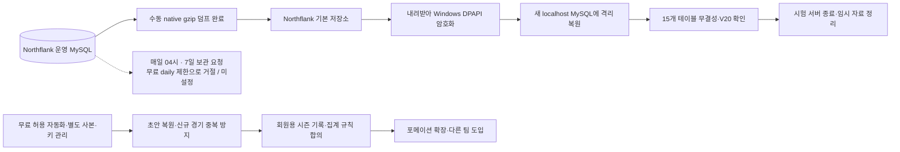

# 조축ON 시스템 구성도와 업무 흐름도

기준일: 2026-10-15. 이런 문서를 **시스템 아키텍처 구성도**, **배포 구성도**, **업무 흐름도**라고 부른다. 현재 운영 버전 `dd67f92`와 로컬 후속 작업, 검토 중인 기능을 구분한다. 실제 회원 정보·팀 코드·접속 비밀번호는 포함하지 않는다.

사용자용 그림 4장은 [전체 열람본](diagrams/system-overview/index.html)에 있으며, 내려받은 프로젝트에서는 이 HTML 파일을 브라우저로 열면 된다. GitHub에서는 아래 SVG 미리보기를 바로 볼 수 있다. 아래 Mermaid는 흐름을 설명하는 텍스트 원본이고, SVG/HTML 생성 소스는 [Generate-SystemOverview.mjs](../scripts/Generate-SystemOverview.mjs)다.

그림 내용이나 배치를 수정할 때 생성 소스를 갱신한 뒤 프로젝트 루트에서 `node scripts/Generate-SystemOverview.mjs`를 실행한다(Node.js 24, 추가 패키지 없음). 설명 문서의 Mermaid·문구도 함께 맞추고 생성된 `docs/diagrams/system-overview/` 파일을 같은 커밋에 반영한다. 문서용 그림에는 실제 회원 정보·접속 비밀값을 넣지 않는다. 운영 설정 화면 캡처는 Git 제외 `outputs/`에만 보관한다.

로컬 확장판에는 선수 시즌 기록과 포메이션 여섯 종류(4백 4종·3백 2종)를 추가했다. 운영 구성은 그대로이며, [별도 포메이션 그림과 기능 명세](player-stats-and-formations.md)에 운영 미반영 상태를 표시한다.

모바일 02·03의 [스쿼드 한눈에 보기와 직접 편집 흐름](mobile-squad-overview.md)도 로컬에 추가했다. 전체화면 작전판에서 배치·교체·골·도움을 기존 초안에 반영하고 단계별 저장을 사용하며, 저장 API·집계·배포 구조는 유지한다.

## 그림 미리보기

## 1. 시스템 아키텍처와 운영 위치

| 구성 | 현재 역할과 상태 |
| --- | --- |
| React 19.3 / TypeScript 7 / Vite 8.3 | 화면 구현·타입 검사·정적 파일 빌드. 운영 서버에서 Vite 개발 서버를 실행하는 구조는 아니다. |
| Caddy 2 | React 파일 제공, 같은 주소의 `/api`를 내부 API로 전달. HTTPS는 앞단 Northflank가 처리한다. |
| Java 21 / Spring Boot 4.1.1 | 인증·팀 권한·선수·경기·자동 편성·엑셀 처리. 기능별 패키지의 단일 API 애플리케이션. |
| Spring Security / JPA | 서버 세션·CSRF·접근 권한 검증, Entity·Repository·트랜잭션으로 DB 접근. JWT·MyBatis를 쓰는 구조는 아니다. |
| MySQL 8.4.11 / Flyway V20 | 실제 자료 저장, DB 변경 이력 관리. 웹/API/DB가 각각 실행된다. |
| OR-Tools / Apache POI | 참석 명단 기반 스쿼드 자동 편성 / 엑셀 양식·업로드 처리. |
| PWA / Capacitor 8 | PWA 제공, 인터넷 연결 필요. Capacitor는 준비 단계이며 스토어·TestFlight 배포는 아직 하지 않았다. |
| GitHub Actions / Docker | 코드 검증 및 재현 가능한 빌드. Docker는 DB 자체나 저장소가 아니라 실행 환경을 묶는 도구다. |

Northflank 무료 시범 환경은 웹 0.1 shared CPU/256MB, API 0.2 shared CPU/512MB, MySQL 0.2 shared CPU/512MB/6GB이며 각각 1개 인스턴스다. 전용 서버 전체를 소유하는 구성이나 여러 서버에 분산된 고가용성 구성으로 설명하지 않는다. API 세션은 메모리에 있어 재배포 시 재로그인이 필요할 수 있다.

## 2. 사용자와 경기 기록의 업무 흐름

- 4-1-2-3 한 포메이션으로 1~4쿼터를 구성한다. 선호 순위, GK 그룹, 출석 우선권, 연속 휴식 방지, 앞 3쿼터 교체 최소화 규칙이 편성에 반영된다.
- 외부 경기는 우리 팀을 기록하고, 자체전은 하루 전체를 A팀/B팀으로 나눠 기록한다. 자체전 A/B는 서비스의 서로 다른 클럽을 뜻하지 않는다.
- 교체된 두 선수는 해당 쿼터를 각 0.5쿼터로 계산한다. 쿼터 길이는 저장하지 않는다.
- 서비스 관리자 권한만으로 모든 팀 기록을 열람·수정하지 않는다. 선수 명단의 직책도 로그인 계정의 실제 권한과 별개다.
- `기록 완료`는 명시적으로 누르는 상태 표시다. 완료만 통계에 포함하거나 이후 수정을 막는 정책은 아직 적용되지 않았다.

## 3. 개발·협업·배포 흐름

현재는 **CI 자동화 + 배포 수동 실행**이다. GitHub에 올리는 것만으로 운영 서버가 자동 갱신되도록 켜두지 않았다. 앱 소스는 `frontend/`와 `backend/`가 한 저장소에 있고, 운영 시 웹/API는 별도 컨테이너로 실행된다. Flyway는 DB 변경만 맡는다.

운영 `dd67f92`의 CI 기록: Java 단위/API 211개, Docker MySQL 통합 91개, 프론트 45개 통과. 이 수치는 해당 배포 시점의 기록이며 최신 로컬 확장판의 검증 수치는 검증 기록에 따로 기록한다. 밤사이 보완 코드는 로컬 변경 상태이며, 사용자 요청에 따라 그림·생성 소스·설명 문서는 GitHub에서도 관리한다. 이 그림 갱신으로 앱 배포·DB 마이그레이션은 하지 않는다.

## 4. 백업·복구와 다음 순서

수동 native 백업은 2026-10-15 08:38 KST 완료됐다. 격리 복원까지 검증했지만 자동 예약은 아직 없다. 승인된 임시 Addons Update 권한을 추가한 뒤, API의 `daily` 무료 계정 제한(400)을 확인하고 즉시 회수했다. 변경 전후 전체 권한 상태 일치 및 기존 백업 보존을 확인했다. 다른 무료 주기나 외부 자동화는 아직 설정하지 않았다.

DPAPI 사본은 현재 Windows 사용자에 종속된다. PC 분실·Northflank 계정 장애까지 대비한 독립 사본과 키 보관, 정기 복원·실제 복구 시간 측정은 다음 과제다. 자동 예약·외부 저장소·서버 이전을 완료된 것으로 표시하지 않는다.

## 확인 근거

- 소스: `frontend/package.json`, `backend/build.gradle`, `deploy/Caddyfile.northflank`, `Dockerfile`, `.github/workflows/ci.yml`, `frontend/vite.config.ts`, Flyway V1~V20.
- [전체 구조 설명](architecture.md), [운영 배포 상태와 백업 검토](northflank-deployment.md), [검증 기록](verification.md).
- [경기 작성 상태](match-recording-progress.md), [모바일 화면](mobile-match-layout.md), [발전 방향과 로드맵](roadmap.md).
- 오늘 수행: 백업 설정 시도·권한 회수·읽기 전용 백업 상태 조회·공개 HTTPS 9개 점검. 실제 운영 자료 시험 수정 및 전체 앱 회귀 테스트는 수행하지 않았다.
