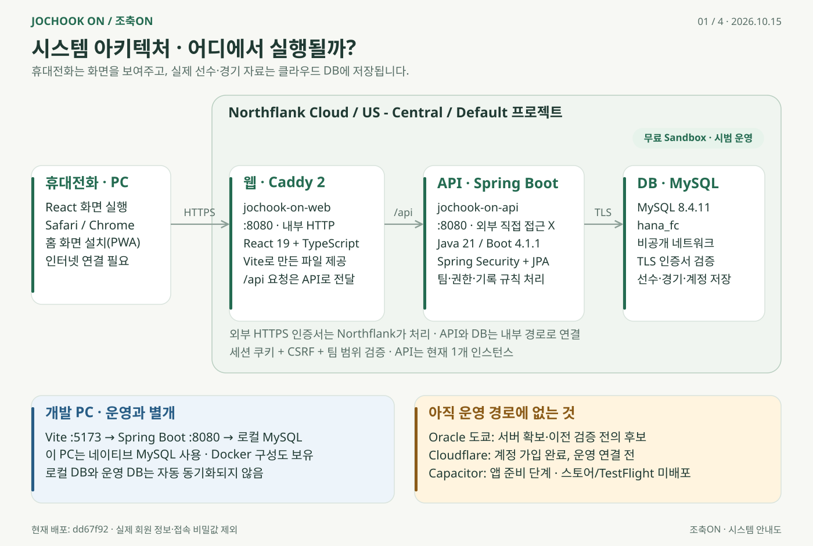
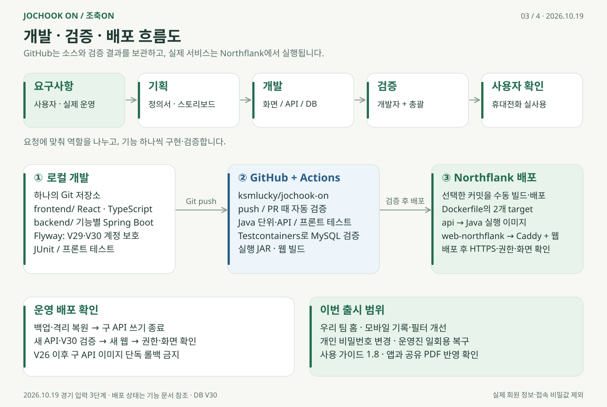
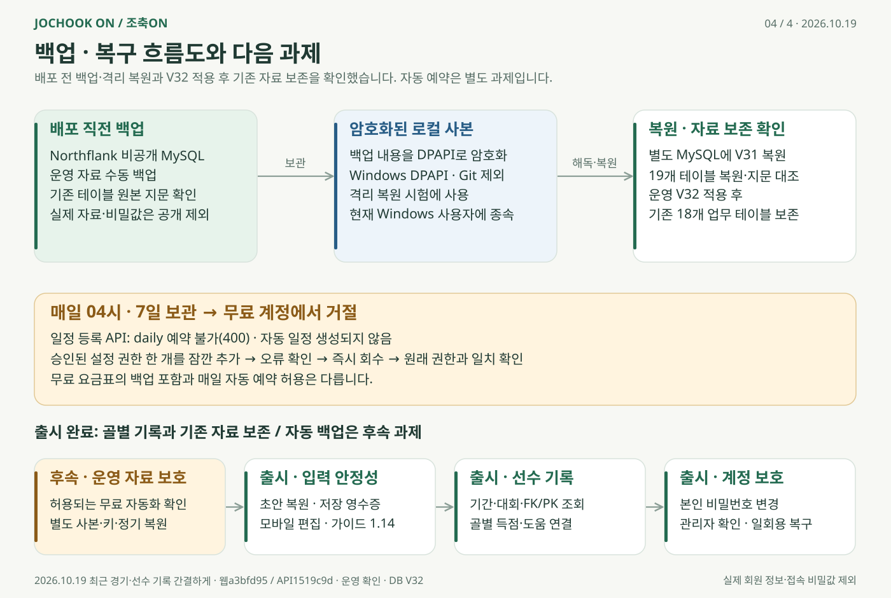
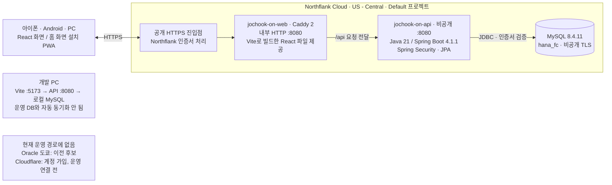
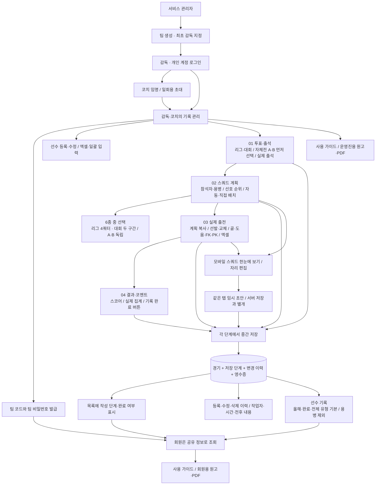
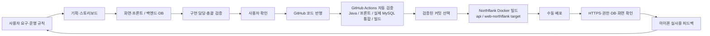
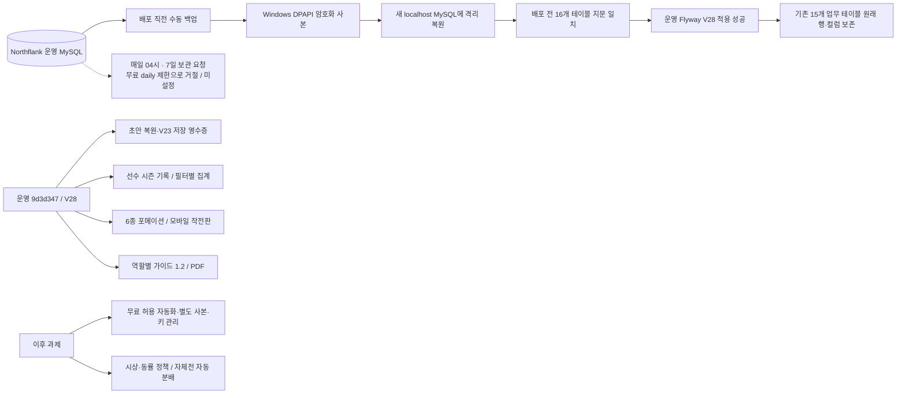

# 조축ON 시스템 구성도와 업무 흐름도

개발 브랜치의 새 홈·개인 비밀번호 변경·운영진 복구 링크·V29/V30 흐름은 [후속 개발 그림](diagrams/home-account-followup/index.html)과 [개발 ERD](database-diagram.md)에 별도로 반영했습니다. 아래 운영 구성도는 배포 전까지 기존 상태를 유지합니다. 서버·네트워크 변경은 없습니다.

**2026.10.15 대회·기록 확장판 · 운영 `9d3d347` · Flyway V28**

이런 문서를 **시스템 아키텍처 구성도**, **배포 구성도**, **업무 흐름도**라고 부른다. 이번 문서는 2026-10-15 23:45 KST에 확인한 운영 구조를 설명한다. 웹과 API의 배포 커밋은 `9d3d3473fd00a31c42924d7fd47a5b4772334fe8`이며, 이전 `b9d8738` / Flyway V23에서 V24~V28과 새 웹/API를 반영했다. 실제 회원 정보·팀 코드·접속 비밀번호는 포함하지 않는다.

사용자용 그림 4장은 [전체 열람본](diagrams/system-overview/index.html)에 있으며, 내려받은 프로젝트에서는 이 HTML 파일을 브라우저로 열면 된다. GitHub에서는 아래 SVG 미리보기를 바로 볼 수 있다. 아래 Mermaid는 흐름을 설명하는 텍스트 원본이고, SVG/HTML 생성 소스는 [Generate-SystemOverview.mjs](../scripts/Generate-SystemOverview.mjs)다.

그림 내용이나 배치를 수정할 때 생성 소스를 갱신한 뒤 아래 명령을 프로젝트 루트에서 실행한다(Node.js 24, 추가 패키지 없음). 설명 문서의 Mermaid·문구도 함께 맞추고 생성된 SVG/HTML을 같은 커밋에 반영한다. 문서용 그림에는 실제 회원 정보·접속 비밀값을 넣지 않는다. 운영 설정 화면 캡처는 Git 제외 `outputs/`에만 보관한다.

```powershell
node scripts/Generate-SystemOverview.mjs
node scripts/Generate-FormationGuide.mjs
node scripts/Generate-DraftRecoveryGuide.mjs
node scripts/Generate-MobileWorkflowGuide.mjs
```

이번 운영 버전에 선수 시즌 기록, 포메이션 여섯 종류(4백 4종·3백 2종), 모바일 스쿼드 전체보기·직접 편집, 같은 탭의 초안 복원·저장 재시도, 앱의 역할별 사용 가이드를 반영했다. Northflank의 웹/API/DB 배포 구조는 유지한다. 생성 소스와 문서·열람본의 기준 버전도 같은 운영 커밋으로 맞췄다.

| 설명 그림 | 생성 원본 | 관련 기능 설명 |
| --- | --- | --- |
| [포메이션 6종](diagrams/formation-guide.svg) | [Generate-FormationGuide.mjs](../scripts/Generate-FormationGuide.mjs) | [선수 시즌 기록과 포메이션](player-stats-and-formations.md) |
| [초안·저장 재시도](diagrams/match-draft-recovery.svg) | [Generate-DraftRecoveryGuide.mjs](../scripts/Generate-DraftRecoveryGuide.mjs) | [초안 복원·저장 영수증](match-draft-recovery.md) |
| [모바일 작전판·가이드 메뉴](diagrams/mobile-workflow-guide.svg) | [Generate-MobileWorkflowGuide.mjs](../scripts/Generate-MobileWorkflowGuide.mjs) | [스쿼드 전체보기](mobile-squad-overview.md), [앱 사용 가이드](in-app-user-guide.md) |

## 그림 미리보기

아래 구성도는 운영 `9d3d347` / V28 기준이다. DB 테이블의 PK/FK와 관계는 [DB 관계도](database-diagram.md)에서 별도로 확대해 볼 수 있다. 기존 모바일 PNG는 가상 자료로 촬영한 당시 화면으로 보존하고, SVG 흐름도는 생성 원본과 함께 관리한다. 그림·문서 후속 갱신은 앱을 다시 배포하는 작업과 별개다.








## 1. 시스템 아키텍처와 운영 위치



| 구성 | 운영 역할과 상태 |
| --- | --- |
| React 19.3 / TypeScript 7 / Vite 8.3 | 화면 구현·타입 검사·정적 파일 빌드. 운영 서버에서 Vite 개발 서버를 실행하는 구조는 아니다. |
| Caddy 2 | React 파일 제공, 같은 주소의 `/api`를 내부 API로 전달. HTTPS는 앞단 Northflank가 처리한다. |
| Java 21 / Spring Boot 4.1.1 | 인증·팀 권한·선수·경기·자동 편성·엑셀·시즌 통계·저장 영수증 처리. 기능별 패키지의 단일 API 애플리케이션. |
| Spring Security / JPA | 서버 세션·CSRF·접근 권한 검증, Entity·Repository·트랜잭션으로 DB 접근. JWT·MyBatis를 쓰는 구조는 아니다. |
| MySQL 8.4.11 / Flyway V28 | V24 대회, V25 FK/PK, V26 3백 자리 변경, V27 사전 A/B팀, V28 경기 형식. 운영 적용과 기존 업무 자료 보존을 확인했다. |
| OR-Tools / Apache POI | 참석 명단 기반 스쿼드 자동 편성 / 엑셀 양식·업로드 처리. |
| PWA / Capacitor 8 | PWA 제공, 인터넷 연결 필요. Capacitor는 준비 단계이며 스토어·TestFlight 배포는 아직 하지 않았다. |
| GitHub Actions / Docker | 코드 검증 및 재현 가능한 빌드. Docker는 DB 자체나 저장소가 아니라 실행 환경을 묶는 도구다. |

Northflank 무료 시범 환경은 웹 0.1 shared CPU/256MB, API 0.2 shared CPU/512MB, MySQL 0.2 shared CPU/512MB/6GB이며 각각 1개 인스턴스다. 전용 서버 전체를 소유하는 구성이나 여러 서버에 분산된 고가용성 구성으로 설명하지 않는다. API 세션은 메모리에 있어 재배포 시 재로그인이 필요할 수 있다.

## 2. 사용자와 경기 기록의 업무 흐름



- 4-1-2-3, 4-4-2, 4-2-3-1, 4-1-4-1, 3-5-2, 3-4-3 중 골라 경기 전체 구간에 적용한다. 3-5-2는 CAM·LWB/RWB, 3-4-3은 LM/RM을 쓴다. 자체전은 01에서 A/B팀을 정한 뒤 02 후보·자동 편성·직접 배치에 같은 명단을 사용한다. 외부 경기의 선호 순위·GK 그룹·출석 우선권·연속 휴식·교체 최소화 규칙은 형식에 맞게 계산한다. 자동 팀 분배·쿼터별 포메이션 변경은 이후 범위다.
- 외부 경기는 우리 팀을 기록하고, 자체전은 하루 전체를 A팀/B팀으로 나눠 기록한다. 자체전 A/B는 서비스의 서로 다른 클럽을 뜻하지 않는다.
- 교체된 두 선수는 구간을 각 0.5쿼터로 계산한다. 새 대회는 30분 전·후반을 두 구간으로 저장하고 풀타임은 2쿼터다. 기존 4쿼터는 유지한다. 구간별 분 입력 없이 경기 형식을 저장하며 쿼터 합산에 시간 환산을 적용하지 않는다.
- 서비스 관리자 권한만으로 모든 팀 기록을 열람·수정하지 않는다. 선수 명단의 직책도 로그인 계정의 실제 권한과 별개다.
- `기록 완료`는 명시적으로 누르는 상태 표시다. 선수 기록의 기본 필터는 올해·완료·전체 유형(자체전 포함)·용병 제외다. 완료 후 수정할 수 있으며 중간 저장하면 작성 중으로 바뀌므로 기본 집계에서 빠질 수 있다. 이전 작성 상태 없는 기록은 기존 기록 포함 정책을 따른다. 경기 종류·기록 상태·용병 포함은 필터로 바꾸며 연말 시상·동률 정책은 아직 정하지 않았다.
- 상단 메뉴는 **선수단 / 경기 기록 / 선수 기록 / 대회 / 사용 가이드**다. 감독·코치는 운영진용, 회원·팀 코드 접속은 회원용 가이드를 본다. 가이드와 공유 PDF는 `docs/guides/content.json`을 공통 원본으로 사용하며, 가이드 열람이 계정 권한을 바꾸지 않는다.

### 초안과 저장 영수증의 경계

`sessionStorage`는 같은 탭의 계정·팀별 임시 초안 한 개를 최대 24시간 보관한다. 직접 로그아웃하면 삭제하며 탭 종료 이후 복구나 다른 기기 동기화는 보장하지 않는다. 비밀번호·팀 코드·인증 토큰은 저장하지 않지만 입력 중인 선수 이름 등 경기 초안 자료는 포함한다.

단계별 서버 저장은 UUID와 정확한 요청을 먼저 임시 보관하고 전송한다. V23 영수증은 팀·인증 계정·UUID로 구분하고 요청 지문과 결과 ID/version·시각을 저장한다. 경기·변경 이력·영수증은 한 트랜잭션으로 처리한다. 응답 유실 시 결과부터 확인한 뒤 같은 UUID·같은 내용으로 재시도하며, 내용 변경이나 이미 수정·삭제된 결과는 충돌로 막는다. 다른 팀·계정의 영수증을 조회할 수 없다.

모바일 전체보기의 **입력 완료 · 작전판으로**, 닫기, Escape는 현재 초안을 유지하며 돌아오는 동작이다. DB 저장은 원래 화면의 **계획 저장 · 실제 기록으로**, **출전 기록 저장 · 집계 확인** 등 단계별 저장 버튼으로 한다.

## 3. 개발·협업·배포 흐름



현재는 **CI 자동화 + 배포 수동 실행**이다. GitHub에 올리는 것만으로 운영 서버가 자동 갱신되도록 켜두지 않았다. 앱 소스는 `frontend/`와 `backend/`가 한 저장소에 있고, 운영 시 웹/API는 별도 컨테이너로 실행된다. Flyway는 DB 변경만 맡는다.

이번 운영 커밋의 CI는 Java 단위/API **454개**, Docker MySQL 통합 **145개**, 프론트 **245개**를 통과했다. 웹/API 모두 `9d3d347`로 완료됐으며 2026-10-15 23:45 KST에 V28·기존 자료 보존·공개 HTTPS·JS/CSS/PDF 해시·로그인·조회·권한을 확인했다. [상세 배포 결과](release-tournament-expansion-2026-10-15.md)에서 실제 실행과 미실행 범위를 구분한다.

상세 실행 근거와 범위는 [검증 기록](verification.md), [운영 배포 상태](northflank-deployment.md), [이번 배포 기록](release-tournament-expansion-2026-10-15.md)을 따른다. 이 그림 생성 작업 자체로 앱 배포·DB 마이그레이션을 수행하지 않는다.

## 4. 백업·복구와 다음 순서



이번 배포 직전 DPAPI 백업을 격리 MySQL에 복원해 **16개 테이블의 지문 일치**를 확인했다. V28 운영 적용 후 **기존 15개 업무 테이블의 원래 행·컬럼 보존**을 확인했다. V26의 의도된 3백 자리 변환은 별도 비교하며, 이번 운영 기존 경기는 4-1-2-3여서 실제 자리 변경은 없었다. 새 대회 테이블과 FK/PK·사전팀·경기형식 컬럼은 원래 자료 비교와 구분한다. 자동 예약 설정을 뜻하지 않는다. V26 이후 구 API 이미지만 롤백하지 않는다.

앞서 2026-10-15 08:38 KST 수동 native 백업과 V20 격리 복원도 확인했다. 자동 예약은 아직 없다. 승인된 임시 Addons Update 권한을 추가한 뒤, API의 `daily` 무료 계정 제한(400)을 확인하고 즉시 회수했다. 변경 전후 전체 권한 상태 일치 및 기존 백업 보존을 확인했다. 다른 무료 주기나 외부 자동화는 아직 설정하지 않았다.

DPAPI 사본은 현재 Windows 사용자에 종속된다. PC 분실·Northflank 계정 장애까지 대비한 독립 사본과 키 보관, 정기 복원·실제 복구 시간 측정은 다음 과제다. 자동 예약·외부 저장소·서버 이전을 완료된 것으로 표시하지 않는다.

## 확인 근거

- 소스: `frontend/package.json`, `frontend/src/App.tsx`, `backend/build.gradle`, `deploy/Caddyfile.northflank`, `Dockerfile`, `.github/workflows/ci.yml`, `frontend/vite.config.ts`, Flyway V1~V28.
- [전체 구조 설명](architecture.md), [운영 배포 상태와 백업 검토](northflank-deployment.md), [검증 기록](verification.md).
- [경기 작성 상태](match-recording-progress.md), [모바일 화면](mobile-match-layout.md), [발전 방향과 로드맵](roadmap.md).
- 배포 상태·CI·원본 자료 보존은 총괄이 확인한 운영 검증 결과를 반영했다. 그림 담당은 생성 원본·열람본·설명 문서만 갱신하며 운영 앱·실제 DB·클라우드 자원을 직접 변경하지 않았다.
- 이번 그림은 생성기 7개와 SVG 10개를 갱신하고 XML·PNG 렌더에서 글자와 배치를 확인했다. 기존 모바일 PNG는 당시 가상자료 검증 화면이다. 구성도 HTML 탭 동작과 실제 앱 검증은 별도 범위다.
