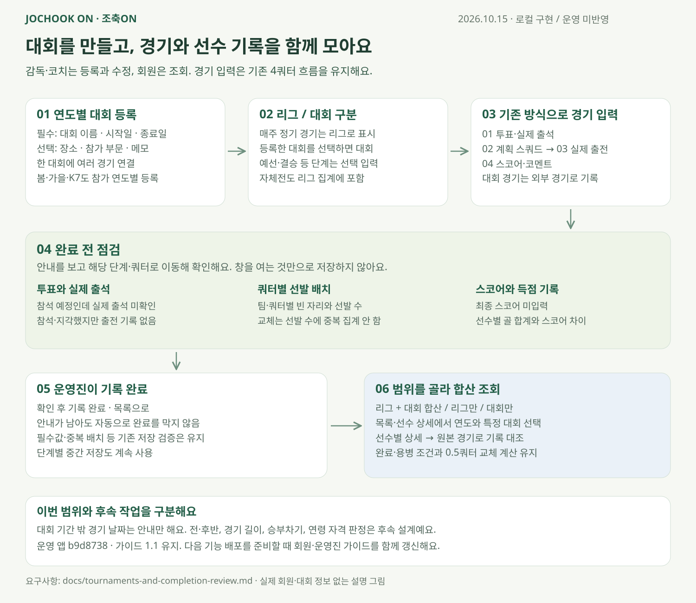

# 대회 관리와 경기 완료 전 점검

2026-10-15 로컬 구현·검증 완료. 운영 앱 `b9d8738`에는 아직 없는 기능이다.

## 합의한 범위

- 대회명·시작일·종료일·장소·참가 부문·메모를 팀별로 관리한다. 대회명과 기간은 필수이며 나머지는 선택이다.
- 경기 하나는 대회 하나에 연결하거나 매주 하는 **리그** 경기로 둔다. 대회가 연결된 외부 경기는 **대회**, 대회가 없는 외부 경기는 **리그**로 표시한다. **자체전**은 별도로 유지한다. 여기서 리그는 정기 경기의 표시명이며 별도 리그 순위표나 리그 관리 기능을 뜻하지 않는다.
- 대회 단계는 예선·16강·8강·준결승·결승·3/4위전·기타 중 선택할 수 있으며 미입력도 허용한다.
- 경기 목록의 날짜 옆에 리그(파랑)·대회(금색)·자체전(회색) 배지를 표시하고 카드 왼쪽 색상으로도 구분한다. 대회명·단계는 별도 강조 영역에 표시한다. 편집/조회 상단과 선수별 경기 기록도 같은 구분을 사용하며 색상만으로 의미를 전달하지 않는다. 기존 DB 저장값·집계·저장 요청은 바꾸지 않는다.
- 경기 입력은 기존 4쿼터를 유지한다. 전·후반, 경기 길이, 승부차기, 대회 전용 통계 환산·연령 자격 판정은 후속 설계다.
- 대회 기간 밖의 경기 날짜는 안내하되 저장을 막지 않는다. 일정 변경·연기 상황에서 기존 기록이 막히지 않도록 한다.
- 회원은 조회, 감독·코치는 등록·수정한다. 이번에는 대회 삭제를 제공하지 않는다.
- 사용자가 언급한 실제 대회의 일정·장소·참가 부문은 추측하지 않는다. 기능 확인에는 가상 대회만 사용한다.

## 리그·대회 필터와 연도별 대회 등록 (2026-10-15 후속)

- 매주 정기 경기는 리그, 등록한 봄·가을 대회와 K7 같은 공식 대회는 대회로 묶는다. 공식 명칭에 ‘리그’가 있어도 앱의 매주 정기 경기 분류와 혼동하지 않는다. 자체전은 별도다.
- 대회는 참가 연도별로 따로 등록한다. `2026 봄대회`, `2026 가을대회`, `2027 K7`은 이름 예시이며 실제 일정과 등록 자료를 생성하지 않는다. 현재 대회 이름·시작/종료일·장소·참가 부문·메모를 그대로 사용한다. 반복 일정이나 자동 연도 복제는 이번 범위가 아니다.
- 경기 기록의 **경기 구분**에서 **전체 경기 / 리그만 / 대회만 / 특정 대회**를 선택한다. 전체에는 자체전도 포함하며, 리그만·대회만은 외부 경기만 조회한다. 필터를 변경하면 첫 페이지로 돌아가고 서버가 전체 대상에 조건을 적용한 뒤 10개씩 나눈다.
- 선수 기록 기본값은 선택 연도의 **리그 + 대회**, **기록 완료만**, **회원만**이다. 경기 구분으로 리그만·대회만·특정 대회를 고를 수 있고, 선택한 범위의 모든 경기 득점·도움·출전·실제 참석을 합산한다. 목록 합계와 선수 상세·원본 이동에 같은 필터를 사용한다.
- 선수 기록의 경기 유형을 자체전이나 자체전 포함 전체로 바꾸면 리그/대회 조건과 특정 대회 선택을 해제한다. 반대로 리그만·대회만·특정 대회를 선택하면 경기 유형을 외부 경기로 맞춘다. 연도·기록 완료 범위·용병 포함 조건은 유지한다.
- 대회 목록을 불러오지 못해도 전체/리그만/대회만 조건은 사용할 수 있다. 이미 고른 특정 대회는 조회 실패 때문에 임의로 해제하지 않는다.
- 외부 경기에서만 `합산 = 리그만 + 대회만`이 성립한다. 모든 합산에는 같은 연도·완료 범위·용병 조건을 사용하고, 미래 경기와 경기 전 계획은 기존 규칙대로 제외한다. 대회 전체와 특정 대회를 동시에 더하지 않는다.

스토리보드: 경기 목록 → 경기 구분 `리그만` → 리그 카드·페이징 → `대회만` 또는 개별 대회 → 연결 경기. 선수 기록 → 시즌/완료 범위를 유지한 채 경기 구분 변경 → 범위와 합계 확인 → 선수 상세 → 원본 경기 → 같은 필터로 복귀. 운영진은 목록의 **대회 등록·관리** 또는 상단 **대회** 메뉴에서 연도별 대회를 등록한다.

인수 기준: 두 리그 경기와 서로 다른 두 대회에 나눠 기록한 가상 선수의 합계·경기 수·0.5쿼터·참석 수를 분리/합산해 대조한다. 자체전·미래·작성 중·다른 팀 자료가 조건 밖에서 섞이지 않아야 한다. 빈 결과·10개 초과 목록·특정 대회 ID의 권한·모순된 조건도 검사한다. 이번 변경의 검증 결과는 [검증 기록](verification.md)에 따로 남긴다.

## 화면 흐름

1. **대회** 메뉴에서 대회를 등록한다. 한 번 등록한 대회에 여러 경기 기록을 연결한다.
2. **경기 보기**를 누르면 해당 대회로 필터된 경기 목록을 연다.
3. 새 경기 또는 기존 경기의 **리그 / 대회**에서 **리그 · 매주 하는 경기** 또는 등록한 대회를 선택한다. 대회는 **대회 단계**도 선택할 수 있다. 경기별 스코어·선수 기록은 기존 방식으로 입력한다.
4. **04 결과·코멘트**의 **완료 전 확인**에서 확인할 항목을 보고 해당 단계·쿼터로 이동한다.
5. 운영진이 확인 후 기존 **기록 완료 · 목록으로**를 누른다. 안내 항목이 남았다는 이유만으로 완료를 막지 않는다.
6. **선수 기록**에서도 대회를 골라 합계·선수별 상세·원본을 확인한다. 시즌과 대회 조건을 함께 적용한다.

[그림 생성 원본](../scripts/Generate-TournamentWorkflow.mjs). 실제 대회 일정·회원 정보를 넣지 않은 개발 흐름도이며 운영 가이드와 구분한다.

## 완료 전 점검

- 참석 예정으로 투표했으나 실제 출석이 미확인인 선수
- 쿼터별·팀별 실제 선발 배치 인원과 빈 자리. 교체 선수는 선발 인원에 중복으로 세지 않는다.
- 실제 참석·지각이지만 실제 출전이 없는 선수
- 최종 스코어 미입력 또는 선수별 골 합계와 스코어 차이

참석만 했거나 득점자를 모르는 경우도 있으므로 안내를 오류로 단정하지 않는다. 기존 필수값·중복 배치·출석과 실제 출전의 불일치·도움 합계 검증은 유지하며 새로운 자동 완료·강제 완료 조건을 만들지 않는다. 점검 창을 여는 것만으로 DB나 초안을 변경하지 않는다.

## 데이터·API 계약

`tournaments`는 팀 ID·버전·이름·기간·장소·참가 부문·메모를 보관한다. 새 Flyway V24로 만들고 `match_records`에 nullable 대회 ID·단계를 추가한다. 기존 경기·통계는 대회 미지정으로 보존한다.

`GET /api/v1/tournaments?page=0&size=10` 및 `GET /{id}`는 회원·운영진 조회다. `POST`와 `PUT /{id}`는 감독·코치만 사용한다. 페이지 크기 최대 100, 버전 충돌은 409이며 다른 팀 대회는 조회·연결할 수 없다. 대회명 120자, 장소 120자, 참가 부문 80자, 메모 3,000자를 제한한다.

경기 목록·시즌 통계·선수별 경기 상세는 선택적인 `tournamentId` 필터를 공유한다. 표시용 대회명은 요청에서 신뢰하지 않고 서버에서 읽는다. 경기 연결 변경은 기존 경기 변경 이력에 남기며, 초안 복원·저장 재시도에도 대회 선택과 단계가 보존되어야 한다. 구버전 요청에서 대회 항목을 생략한 경우 기존 연결을 임의로 지우지 않는다.

## 검증과 가이드

팀 격리·역할·기간 검증·버전 충돌·경기 연결/해제·대회별 통계·기존 기록 보존·초안/재시도·변경 이력과 모바일 5개 메뉴를 가상 데이터로 검증했다. Java 단위/API 325개, Docker MySQL 8.4 통합 123개, 프론트 138개 모두 통과했으며 TypeScript/Vite와 bootJar 빌드도 성공했다. 운영 DB는 변경하지 않았다.

이후 리그/대회 범위 필터를 추가한 상태에서 Java 단위/API 338개·Docker 전체 통합 127개가 통과했다. 합산/리그만/대회만/특정 대회 목록과 선수 합계·상세 왕복도 브라우저에서 확인했다. FK/PK 확장 이후 최신 결과와 Docker 제한은 [검증 기록](verification.md)의 첫 항목을 따른다.

가상 대회 등록 → 대회 선택 경기 저장 → 대회별 목록과 선수 상세/원본 조회 → 대회 단계 초안 보관·복원 → 수정 이력의 `예선 → 준결승` 표시를 실제 브라우저에서 확인했다. 04 점검에서 01 출석·03 배치·04 스코어로 이동하고, 골 합계 차이가 있어도 사용자가 명시적으로 완료할 수 있음을 확인했다. 320/390px의 작은 화면은 확인했지만 실제 아이폰 Safari 터치·설치는 아직 확인하지 않았다.

[가상 대회 경기 목록 화면](diagrams/tournament-match-mobile.png) · [완료 전 점검 화면](diagrams/match-completion-review-mobile.png) · [상세 검증 기록](verification.md)

실제 서초구 대회 정보는 아직 입력하지 않았다. 일정·장소·참가 부문을 확인한 뒤 사용자가 등록할 수 있다. 대회마다 경기 시간을 다르게 환산하거나 연령 자격을 자동 판정하지 않는다.

회원용 가이드는 대회 조회·대회별 경기/선수 기록이, 운영진용은 추가로 대회 등록·수정·경기 연결·완료 전 점검이 갱신 대상이다. 운영 가이드 1.1은 유지하고 개발 문서와 대기 목록에 먼저 기록한다. 다음 배포 때 공통 원고·HTML·PDF·앱 가이드를 함께 갱신한다.
