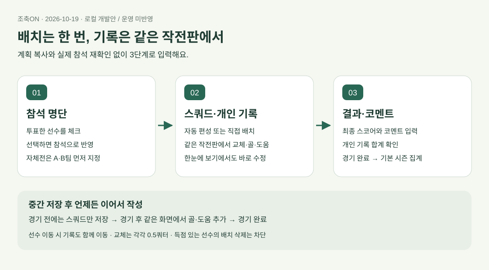

# 경기 입력 통합 — 운영 반영

후속 로컬 변경: [골·도움 연결 기록과 모바일 작전판](goal-events-mobile-2026-10-19.md). 3단계 흐름은 유지하며 02의 자리 선택·골 기록과 고정 저장 동작을 개선합니다. 이 후속 기능은 미배포이며 아래 운영 흐름도의 배포 기준은 변경하지 않습니다.

2026-10-19 10:54 KST. **운영 반영 완료**. 웹 `a229bbb`, API `d8b2763`, DB V30, 가이드 1.8.

## 요구사항과 결정

계획 배치와 실제 출전을 따로 입력·복사하는 부담을 줄인다. 사용자는 참석 투표자를 실제 참석자로 간주하며 **경기 완료 버튼만 유지**하기로 결정했다. 기본 시즌 통계의 완료 조건은 바꾸지 않는다. 중간 저장한 경기까지 포함하는 기존 조회 옵션은 유지한다.

1. **01 참석 명단**: 참석 투표한 선수를 체크하면 PRESENT로 입력한다. 지각은 보존한다. 예외 표에서 불참·지각을 정정할 수 있다. 자체전은 기존 A/B팀별 체크를 사용한다.
2. **02 스쿼드·개인 기록**: 자동 편성, 직접 배치, 자리 교환, 교체, 골·도움·FK·PK, 엑셀 입력을 한 화면에서 처리한다. 일반 작전판의 `배치·기록` 또는 한눈에 보기의 `배치·기록 수정`으로 편집창을 연다.
3. **03 결과·코멘트**: 스코어·메모와 출전 선수별 합계를 확인한다. `기록 완료 · 목록으로`가 COMPLETED로 저장한다. 중간 저장은 작성 중 상태다.

경기 전에는 02까지 작성하고 `중간 저장 · 목록으로`를 누른다. 경기 후 같은 기록을 열어 02의 골·도움과 03의 결과만 추가한다. 별도의 참석 재확인·계획 복사 버튼은 없다. 골이 0이거나 배치가 비었다는 이유로 완료 여부를 자동 판정하지 않는다.

## 스토리보드

[흐름도 열기](diagrams/unified-match/index.html) · [Mermaid](diagrams/unified-match/workflow.mmd) · [생성 원본](../scripts/Generate-UnifiedMatchWorkflow.mjs)

탭은 3개다. 키보드 좌우/Home/End 탐색과 완료 전 확인의 이동 버튼도 같은 3단계로 연결한다. 기존 목록의 PLAN/ACTUAL은 둘 다 02로 표시하고, RESULT는 03으로 표시한다.

## 저장과 호환성

- DB 스키마·API 계약·권한은 변경하지 않는다. `quarters[].lineup`을 화면의 유일한 배치·개인 기록 원본으로 사용한다. 자동 편성기에만 이 데이터로 만든 임시 계획 뷰를 전달한다. 새 저장의 `plannedLineup`은 빈 배열이다.
- 예전 작성 중 경기에서 실제 출전이 하나라도 있으면 실제 기록 전체를 우선한다. 빈 쿼터를 옛 계획으로 채우지 않는다. 실제 출전이 전혀 없는 작성 중 경기는 계획을 0골·0도움 출전 초안으로 가져온다. 완료된 계획만 있는 경기를 실제 출전으로 자동 변환하지 않는다.
- 실제 출전과 별도로 남아 있던 예전 계획은 다음 저장에서 정리되며 변경 이력의 이전 스냅샷은 유지한다. 안내 문구를 표시한다. 읽기 전용 회원 조회는 출석/계획 전환을 하지 않는다.
- 전반/후반 2구간, 리그/자체전 4구간과 교체 0.5 규칙은 유지한다. 자리 이동 시 같은 쿼터 선수의 골·도움·FK·PK가 함께 이동한다. 이전 쿼터 복사는 배치만 복사하고 다른 쿼터의 득점은 복사하지 않는다.
- 골·도움이 있는 선수를 자동 편성·선수 선택 해제·팀 변경 등으로 제거하면 거부한다. 먼저 기록을 직접 확인·정정해야 한다. 엑셀은 기존의 명시적인 전체 기록 교체 경고와 버튼을 유지한다.
- 자체전의 팀별 후보와 교차 배치 차단은 유지한다. 엑셀로 다른 쿼터의 기존 팀과 충돌해도 거부한다.
- 서버 저장 전까지는 초안이다. 기존 24시간 탭 초안, 응답 유실 영수증, 동일 키 재시도, 충돌 보호를 유지한다. 미확정 요청은 원본 요청을 그대로 보내야 하므로 통합 변환하지 않는다. 예전 내부 단계 인덱스·상태 값도 호환용으로 유지하고 표시만 매핑한다.

## 검증 및 한계

- 프론트 단위·회귀 테스트 **270개 통과**: 통합 배치/출석, 과거 계획 전환, 실제 기록 우선, 완료 보존, 선수별 기록 이동, 기록 유실 차단, 자체전 팀 변경, 2구간·완료 상태. 기존 초안·세션·충돌 테스트 포함.
- 가상 API와 390px 브라우저: 참석 선택 → 단계 저장 → 선발/교체 → 골/PK/도움 → 한눈에 보기 수정 → 결과 합계 → 완료 저장 확인. 자체전 A·B팀 후보 분리 및 키보드 단계 이동도 확인했다. 실제 회원/경기 DB에는 쓰지 않았다.
- TypeScript 검사와 프로덕션 빌드. 기존 번들 500kB 경고는 남아 있다.
- MySQL 통합 테스트, 운영 저장, 실제 iPhone Safari는 이번 작업에서 실행하지 않는다. 서버·DB 변경은 없다.

## 가이드·그림 반영

공통 content.json과 운영진·회원용 앱 가이드·HTML·PDF를 1.8로 갱신했다. 운영진은 참석 체크, 통합 작전판, 개인 기록, 예외와 완료 절차를, 회원은 3개 탭과 작성 상태를 설명한다. 권한과 기본 완료 통계 범위는 그대로다. PDF24쪽을 렌더링해 검토했고 역할별 앱 목차와 PDF 연결을 확인했다.

통합 흐름도, 시스템 업무 흐름, 모바일 작전판, 자체전 팀 배정, 대회 형식 그림의 생성 원본·SVG·PNG·HTML을 맞췄다. 스키마·키·관계 변경이 없어 V30 ERD는 유지했다. HTML/PDF의 본문은 운영 앱에 포함된 1.8과 같고 배포 식별자 메타데이터는 운영 확인 후 문서 커밋으로 확정했다.

## 모바일 검증 화면 (가상 선수)

[통합 작전판](diagrams/unified-match/mobile-board.jpg) · [같은 작전판의 골·도움 편집](diagrams/unified-match/mobile-editor.jpg). 390×844 Chromium 미리보기이며 실제 iPhone 검증을 대신하지 않는다.

## 배포 확인

- Northflank 웹 `a229bbbb6ff99b5c9273f7fb00d7e8dfd0b00603`, 빌드 `windy-sunlight-8772` 배포 완료. 기존 무료 서비스 자원 유지.
- 프론트 270개 테스트·타입 검사·빌드 통과. GitHub CI 성공. 공개 HTTPS 9개, JS/CSS/역할별 PDF 4개 SHA-256이 로컬 검증 빌드와 일치.
- API `d8b2763`와 DB V30 유지. 운영 회원·경기 데이터를 테스트로 수정하지 않았다.
- 실제 iPhone Safari와 운영 로그인 후 쓰기, 이번 로컬 MySQL 통합 테스트는 미실행. 기존 500KB 초과 번들 경고는 후속 성능 개선 대상.
- 폰 확인: 참석 명단 선택 → 같은 02 작전판에서 배치·교체·골·도움 → 중간 저장 후 다시 열기 → 03에서 기록 완료. 이전 화면이면 새로고침한다.
